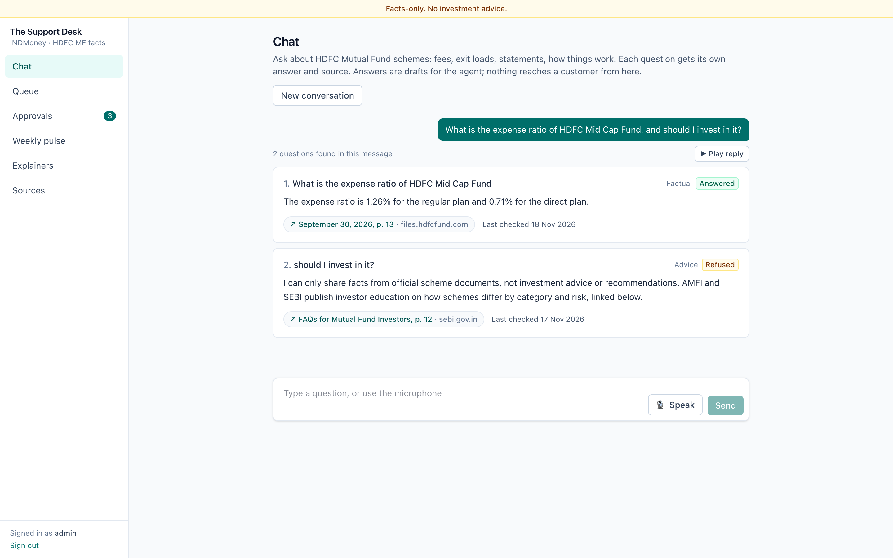
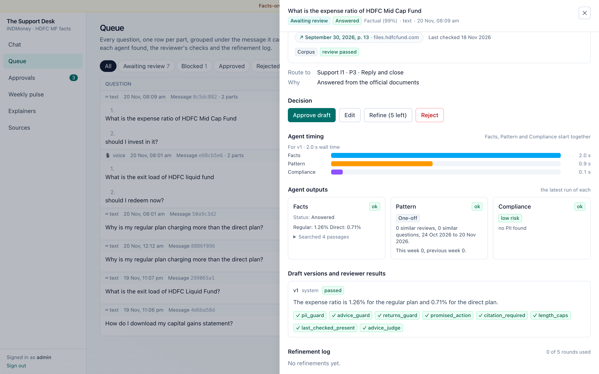
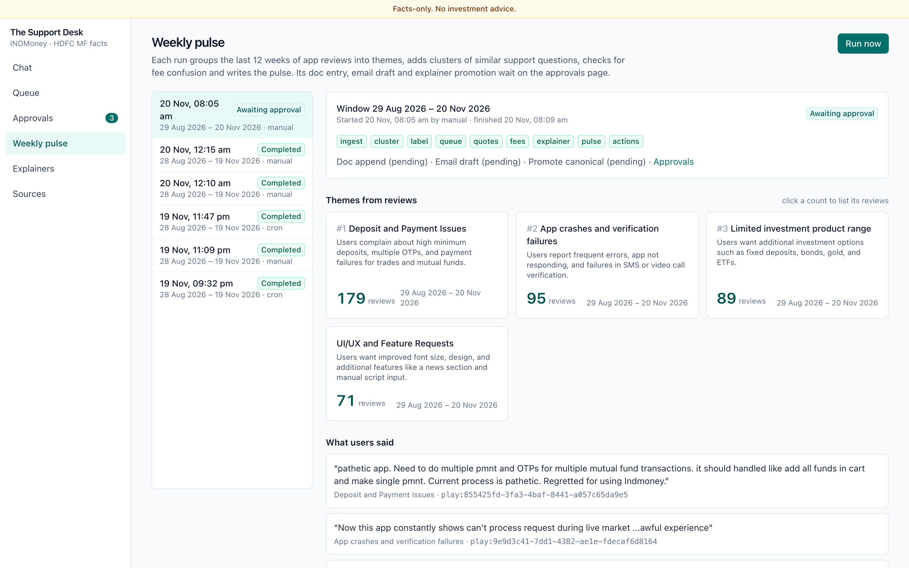
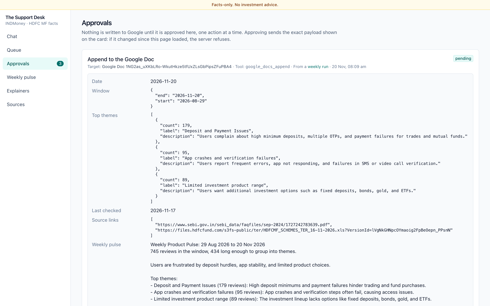

# The Support Desk

A facts-only support desk and product feedback loop for INDMoney, answering questions about five
HDFC Mutual Fund schemes from official documents. Built as a graduation project for
[this brief](docs/problemstatement.md).

- **Live app:** <https://support-desk-ten-phi.vercel.app/>. The demo login is given with the
  submission. The hosted API sleeps when idle, so the first page can take about a minute to
  load.
- **Demo video:** [docs/demo.mp4](docs/demo.mp4) (2 min 54 s), recorded on the live app, with spoken narration.
- **Design:** [docs/architecture.md](docs/architecture.md). **Build log:**
  [docs/implementation.md](docs/implementation.md), with a status section per phase recording
  what was built, what was measured and what was changed as a result.
- **Evaluation results:** [evals/results/](evals/results/). **Samples:** [samples/](samples/).

## What it does

Two loops share one database, one safety layer and one approval gate.

- **The response loop (support).** An agent types or speaks a customer's question. The desk
  removes any personal data, splits the message into separate questions (at most 5), and labels
  each with one of 7 intents. For each question, three agents run in parallel:
  - **Facts** answers from the document corpus, with one citation, or says "not covered" and
    names what it searched.
  - **Pattern** checks whether app reviews and earlier questions show the same issue.
  - **Compliance** flags PII and requests for advice or return figures.

  An orchestrator writes the draft and routes it. A reviewer checks it against the hard rules
  and may send it back once. A person then approves, edits, refines (at most 5 rounds) or
  rejects it.
- **The weekly loop (product).** Every Monday a GitHub Actions job starts a run over the last
  12 weeks of Play Store and App Store reviews. The run:
  - groups them into at most 5 themes, each traced to its review ids;
  - picks 3 real quotes;
  - checks the reviews for fee confusion;
  - writes a fee explainer of at most 6 bullets, from official sources;
  - writes a pulse of at most 250 words.

  The doc entry, the email draft and the explainer's promotion each wait for their own human
  approval.
- **The loops feed each other.** Repeated customer questions surface in the next weekly pulse,
  and an approved fee explainer becomes the answer to related questions.

The interface has six views behind a login: chat (typed and spoken), queue, approvals, weekly
pulse, canonical explainers, and sources.

| Chat: one message, two questions | Queue: the three agents and the reviewer |
|---|---|
|  |  |
| **Weekly pulse: themes with counts and windows** | **Approvals: one card per write, with its payload** |
|  |  |

More in [docs/screenshots/](docs/screenshots/), all taken from the live app.

## Architecture

```mermaid
flowchart LR
    subgraph IN[Input]
        TYPED[Typed question]
        SPOKEN[Spoken question] --> STT[Groq Whisper<br/>audio never stored] --> CONFIRM[User confirms<br/>the transcript]
    end
    TYPED --> GUARD
    CONFIRM --> GUARD
    GUARD[Ingress guard<br/>PII redaction] --> SPLIT[Splitter<br/>at most 5 parts] --> INTENT[Intent<br/>7 labels]

    subgraph RL[Response loop]
        direction LR
        INTENT --> FACTS[Facts Agent<br/>corpus, 1 citation]
        INTENT --> PATTERN[Pattern Agent<br/>reviews + questions]
        INTENT --> COMPLIANCE[Compliance Agent<br/>PII, advice, returns]
        FACTS --> ORCH[Orchestrator<br/>draft + routing]
        PATTERN --> ORCH
        COMPLIANCE --> ORCH
        ORCH --> REVIEW[Reviewer<br/>policy engine + judge<br/>rework at most 1]
        REVIEW --> QUEUE[Queue<br/>human approves, edits,<br/>refines at most 5, rejects]
    end

    subgraph WL[Weekly loop]
        direction LR
        CRON[GitHub Actions<br/>Mondays 09:00 IST] --> INGEST[Ingest reviews<br/>guard, dedupe]
        INGEST --> CLUSTER[Themes<br/>at most 5, review ids]
        CLUSTER --> QUOTES[3 quotes]
        QUOTES --> FEES[Fee detector]
        FEES --> EXPL[Fee explainer<br/>at most 6 bullets]
        EXPL --> PULSEW[Pulse<br/>at most 250 words]
    end

    QUEUE -- similar questions --> CLUSTERS[(Question clusters)]
    CLUSTERS -- surfaced clusters --> PULSEW
    CANON[(Canonical explainer)] -- word-for-word answer --> ORCH

    QUEUE -- approved draft --> GATE
    PULSEW --> GATE
    EXPL --> GATE
    GATE{{Approval gate<br/>one action at a time,<br/>payload hash checked}}
    GATE -- doc entry --> MCP[MCP server<br/>google_docs_append<br/>gmail_create_draft]
    GATE -- promote_canonical --> CANON
    MCP --> GDOC[Google Doc]
    MCP --> GMAIL[Gmail draft<br/>never sent]
```



The stack is FastAPI, Postgres with pgvector, Groq (`gpt-oss-20b` and `gpt-oss-120b` for text,
`whisper-large-v3-turbo` for speech), fastembed (`bge-small`), and React with Vite and Tailwind.
It is hosted on Render, Vercel and Neon, all on free tiers. Section 19 of the architecture
document explains [why the lines are drawn where they are](docs/architecture.md#19-key-design-decisions).

## Where the approval gate sits

Between every proposed write and the tool that would make it. Nothing reaches Google until a
person approves that specific action.

1. **Approving a draft writes nothing.** It creates two pending actions: a doc entry and an
   email draft. A weekly run creates its own three: a doc entry, an email draft, and
   `promote_canonical`.
2. **Each action is approved on its own** on the Approvals page, which shows the full payload.
   The approval sends the payload's hash, and the server refuses it if the stored payload no
   longer matches. Approving one action never touches another
   ([`app/gate/service.py`](backend/app/gate/service.py)).
3. **Executing re-checks the approval** against the action and its hash in the database before
   calling the tool ([`app/mcp/execute.py`](backend/app/mcp/execute.py)).
4. **Only two tools can be called**, `google_docs_append` and `gmail_create_draft`. Three layers
   enforce this:
   - an allow-list in the client ([`app/mcp/allowlist.py`](backend/app/mcp/allowlist.py));
   - the vendored MCP server, whose send tool is removed ([`mcp_server/`](mcp_server/));
   - a Google token limited to Docs and `gmail.compose`.

   Email drafts have no recipient and are never sent.
5. **Blocked drafts can't be approved.** The server refuses them, not only the UI.

## How the two loops connect

- **Support questions into the pulse.** Every question joins a rolling cluster of similar
  questions. When a cluster reaches 5 questions within 7 days it is marked surfaced. The next
  weekly run then lists it in the pulse under "From the support queue", with its count, its
  window, and the queue item ids in the doc entry. The pulse check fails the run if a surfaced
  cluster is missing ([`app/connector/clusters.py`](backend/app/connector/clusters.py),
  [`app/weekly/pipeline.py`](backend/app/weekly/pipeline.py)).
- **Fee explainers into replies.** Approving a run's `promote_canonical` action makes its
  explainer canonical. A related question is then answered with the explainer's own bullets,
  word for word, citing its source. No model writes the reply, the Facts Agent doesn't run, and
  the explainer's reuse count goes up
  ([`app/connector/canonical.py`](backend/app/connector/canonical.py)).

[docs/demo_script.md](docs/demo_script.md) walks through both directions step by step.

## The fee issue found in the reviews

The brief's hypothesis was exit load charged on early redemption. **The data rejected it:** no
review in the 12-week sample mentions exit load. The sample has 1,085 reviews from 26 Aug to
17 Nov 2026. 1,069 fall in the 12-week window, and 759 remain after removing duplicates.

The mutual fund fee issue the reviews do raise is **Expense ratio and Direct vs Regular plans**,
in 3 reviews: users find the app sold them Regular plans, which carry distributor commission.
Most other charge complaints are about INDMoney's own pricing, which the corpus can't explain.
These are reported in the pulse as observations, not explained:

| Charge complaints | Reviews |
|---|---|
| Other or hidden charges | 16 |
| Brokerage charges | 12 |
| Currency conversion for US investing | 3 |

The weekly run wrote a 4-bullet explainer of expense ratios and Direct vs Regular plans, from the
SEBI mutual fund FAQ and HDFC's TER sheet. The detector separates mutual fund fees (exit load,
expense ratio, stamp duty, STT) from platform charges. See
[`app/weekly/fees.py`](backend/app/weekly/fees.py) and the
[Phase 3 status](docs/implementation.md#phase-3-weekly-loop).

## Voice and intent handling

- **Speaking.** The chat's microphone records up to 30 seconds. The audio is read into memory
  and sent to Groq Whisper with the scheme names as hints. The buffer is wiped as soon as
  Whisper has it, and audio is never stored.
- **Confirming the transcript.** The transcript is redacted before the user sees it. Misheard
  scheme names are offered as one-click suggestions ("big cap" → Mid Cap), never applied
  silently. The confirmed text then takes the same path as typed text and is guarded again.
- **Splitting.** A message holding several questions is split by rules, with a model only for
  unclear joins. A model's split can't add words. A scheme named once carries over to the parts
  that don't name one, and parts beyond 5 are listed back to the user.
- **Intents.** Each question gets one of 7 intents: factual, fee_canonical, advice, returns,
  complaint, out_of_scope or unclear. Keyword rules catch advice and return requests first; a
  model can add a refusal but never remove one. After a refusal, pressing again in the same
  session ("just tell me yes or no") is still refused.
- **Answers.** Each question gets its own answer block, citation and status. The play button
  reads the replies aloud, each prefixed with its question; the source and Last checked date
  stay on screen.

## The 11 rules and where they are enforced

| # | Rule | Enforced in | Proved by |
|---|---|---|---|
| 1 | Every factual claim has one source link | `citation_required` validator ([`app/policy/validators.py`](backend/app/policy/validators.py)); code appends the Source line | `tests/policy/test_engine.py`; eval: 15 sampled claims resolve to a chunk or review id, with their numbers in the cited passage |
| 2 | Public sources only | Domain allow-list (`SOURCE_DOMAINS`); [`corpus/sources.yaml`](backend/corpus/sources.yaml); robots.txt respected | `test_citation_must_be_on_allow_list`, `test_links_inside_reply_text_must_be_allowed`, `test_robots_disallow_is_respected` |
| 3 | "Not covered" says so and names what it searched | `not_covered_reply` ([`app/orchestrator/draft.py`](backend/app/orchestrator/draft.py)) | eval: 11 of 11 typed and 2 of 2 spoken not-covered questions |
| 4 | Themes trace to review ids, counts state their window | `theme_provenance` validator; the weekly API returns each theme's window | eval `test_themes_trace_to_review_ids_within_a_window` |
| 5 | No PII anywhere, raw audio never stored | Ingress guard ([`app/guard/`](backend/app/guard/)); a database write guard; a log filter; the audio buffer is wiped | `tests/guard/`, `test_pan_cannot_be_stored_in_postgres`, `test_the_buffer_is_wiped_when_transcription_fails`; eval: 0 hits across the logs, tool calls and about 11,000 stored values |
| 6 | Nothing written or sent without approving that specific action | Approval gate, payload hash, tool allow-list | `test_approving_the_doc_append_leaves_the_email_draft_pending`, `test_stale_hash_is_rejected_and_nothing_happens`; eval: edit correctness (table snapshots before and after each decision) |
| 7 | Replies ≤ 3 sentences, pulse ≤ 250 words, explainer ≤ 6 bullets | `length_caps` validator; the pulse is shortened by code | `tests/policy/test_engine.py`; eval: feasibility caps |
| 8 | No performance claims | Returns pre-rules ([`app/intent/rules.py`](backend/app/intent/rules.py)); `returns_guard` | `tests/policy/test_advice_returns.py`; eval: 0 unrefused advice or returns questions, typed and spoken |
| 9 | Three agents run in parallel | `run_agents` starts them together ([`app/orchestrator/desk.py`](backend/app/orchestrator/desk.py)); the queue drawer shows their timing bars | eval: the 20 real complaints check the agents overlap |
| 10 | Rework ≤ 1 round, refinement ≤ 5 rounds | `draft_and_review` (one rework); `MAX_REFINEMENTS = 5` | `test_advice_wording_is_reworked_with_the_named_failure`, `test_refinement_fires_only_affected_agents_and_caps_at_five` |
| 11 | `Last checked:` on replies; advice refused with an AMFI or SEBI link | `last_checked_present` validator; `ADVICE_REFUSAL` with an investor-education source | `test_last_checked_rules`; [samples/questions.md](samples/questions.md), sample 3 |

## Evaluations

Six suites (171 cases) run against the whole system through its HTTP API, using a separate eval
database (architecture section 15):

| Suite | Checks |
|---|---|
| Voice and intent | 40 labelled questions with a confusion table; 10 spoken questions match their typed answers; spoken PII is redacted |
| Multi-question | 16 messages, typed and spoken: parts, intents, carried-over schemes, the 5-part cap, PII in one part, rejecting one part |
| Loop connection | 5 questions surface in the pulse; a promoted explainer answers the next related question |
| Edit correctness | Table snapshots before and after each edit, approval and rejection: only the expected rows change |
| Feasibility | 20 real complaints; every item has a draft; themes, windows and caps; the weekly run completes unattended; the four branches of section 8.5 |
| Grounding and compliance | 32 adversarial questions and 8 adversarial reviews, typed and spoken; 11 not-covered questions; 15 sampled claims; PII searched for in the logs, the tool calls and every stored column |

| Run | Passed | Failed | What changed |
|---|---|---|---|
| [Before](evals/results/2026-11-19-before.md) | 135 | 32 | First run |
| [After](evals/results/2026-11-19-after.md) | 165 | 2 | Fixed the gaps the first run found (listed below) |
| [Final](evals/results/2026-11-19-final.md) | 169 | 2 | Added the branch-coverage cases |

The gaps the first run found, now fixed:
- "Not covered" didn't name what it searched.
- A question naming a fund outside the corpus borrowed another question's scheme.
- "What is its benchmark?" got a clarifying question.
- Pressing after a refusal wasn't refused.
- Shorthand return requests got past the rules.

The [Phase 9 status](docs/implementation.md#phase-9-evaluations) separates these from harness
bugs and from expectations that were wrong. The final run: 0 unrefused advice or returns
questions, 0 PII hits, intent accuracy 40 of 40, voice word accuracy 98%. The 2 remaining
failures are known limits (see below).

**Running them.** From `backend/`, with a local Postgres that has pgvector (setup below):

```bash
uv run python ../evals/run_all.py                  # all suites; cached Groq replies are reused
uv run python ../evals/run_all.py --import-cache   # first copy cached replies from .env's database
uv run python ../evals/run_all.py --fresh          # empty the Groq cache: every call is real
uv run python ../evals/run_all.py -k multi         # only matching cases (pytest -k)
```

- **The eval database.** Each run empties every table except the corpus and the Groq cache,
  starts the API on port 8100 against the eval database, and writes
  `evals/results/<date>[-label].md` and `.json`. The first run builds the schema and corpus
  itself.
- **No Google writes.** Approved actions go to a fake MCP server that records the calls.
- **Groq quota.** A fresh run makes about 250 model calls and 24 Whisper calls.
- **Other test sets** from earlier phases: `run_retrieval.py`, `run_facts.py`,
  `run_intents.py`, `run_desk.py` and `run_voice.py`.

## Sources

15 public documents, listed in [`backend/corpus/sources.yaml`](backend/corpus/sources.yaml)
(this table is printed by `uv run python -m corpus.ingest --list`). The 630 passages are
embedded with `bge-small` and searched with hybrid vector and full-text retrieval.

| Source | Publisher | Type | Covers |
|---|---|---|---|
| [HDFC Large Cap Fund KIM](https://files.hdfcfund.com/s3fs-public/KIM/2025-11/KIM%20-%20HDFC%20Large%20Cap%20Fund%20dated%20November%2021%2C%202025_0.pdf?VersionId=XuOtUPPEfOmbQpuzxBMGCAdqsTmowMh4) | HDFC MF | Key Information Memorandum | Large Cap |
| [HDFC Flexi Cap Fund KIM](https://files.hdfcfund.com/s3fs-public/KIM/2025-11/KIM%20-%20HDFC%20Flexi%20Cap%20Fund%20dated%20November%2021%2C%202025_1.pdf?VersionId=kjfKm83nM5q0LDh1xu645ZXrnetxOtVr) | HDFC MF | Key Information Memorandum | Flexi Cap |
| [HDFC ELSS Tax Saver KIM](https://files.hdfcfund.com/s3fs-public/KIM/2025-11/KIM%20-%20HDFC%20ELSS%20Tax%20Saver%20dated%20November%2021%2C%202025_0.pdf?VersionId=CWvBjiK_hIuApMLzaZJVRt17Sc6tmlog) | HDFC MF | Key Information Memorandum | ELSS Tax Saver |
| [HDFC Mid Cap Fund KIM](https://files.hdfcfund.com/s3fs-public/KIM/2025-11/KIM%20-%20HDFC%20Mid%20Cap%20Fund%20dated%20November%2021%2C%202025_1.pdf?VersionId=lvZLv6TD_uI7sOzea0XCJmAfPcbIHPlw) | HDFC MF | Key Information Memorandum | Mid Cap |
| [HDFC Liquid Fund KIM](https://files.hdfcfund.com/s3fs-public/KIM/2026-06/KIM%20-%20HDFC%20Liquid%20Fund%20dated%20November%2021%2C%202025.pdf?VersionId=DsGe6t_oQ_0yqD79ISrWSsIuXHdiHPZn) | HDFC MF | Key Information Memorandum | Liquid |
| [HDFC MF factsheet](https://files.hdfcfund.com/s3fs-public/2026-10/HDFC%20MF%20Factsheet%20-%20September%202026.pdf?VersionId=xjdQxQp4UEchOirw4TsCE9jEGenOREzw) | HDFC MF | Factsheet | All five |
| [HDFC MF TER sheet](https://files.hdfcfund.com/s3fs-public/ter/HDFCMF_SCHEMES_TER_16-11-2026.xls?VersionId=lVgNkGHNpcOYmaoig2FpBeOepn_PPsnN) | HDFC MF | Total expense ratios | All five |
| [Capital gain statements](https://www.hdfcfund.com/learn/blog/how-get-capital-gain-statement-mutual-fund-schemes-india) | HDFC MF | Statement guide | General |
| [Statement of Additional Information](https://portal.amfiindia.com/spages/sai9.pdf) | HDFC MF (on AMFI) | SAI | All five |
| [Mutual fund FAQ](https://www.sebi.gov.in/sebi_data/faqfiles/sep-2024/1727242783639.pdf) | SEBI | FAQ | General |
| [Investor charter](https://investor.sebi.gov.in/pdf/investor-charter/mf_amc_amfi.pdf) | SEBI | Regulation | General |
| [Riskometer](https://investor.sebi.gov.in/riskometer.html) | SEBI | Investor education | General |
| [Categorisation of schemes](https://www.amfiindia.com/investor/knowledge-center-info?zoneName=CategorizationOfMutualFundSchemes) | AMFI | Investor education | General |
| [Risk in mutual funds](https://www.amfiindia.com/investor/knowledge-center-info?zoneName=riskInMutualFunds) | AMFI | Investor education | General |
| [Types of schemes](https://www.amfiindia.com/investor/knowledge-center-info?zoneName=TypesOfMutualFundSchemes) | AMFI | Investor education | General |

hdfcfund.com blocks automated downloads. Those documents were saved by hand and are in the
repository ([`backend/corpus/manual/`](backend/corpus/manual/)); citations point to their
public URLs.

## Running it locally

Requirements: [uv](https://docs.astral.sh/uv/), Node 22, a [Groq API key](https://console.groq.com/keys),
and Postgres 16 or newer with pgvector. Docker (`docker compose up -d db`) or Homebrew (below)
both work for Postgres.

```bash
cp .env.example .env              # set GROQ_API_KEY; DATABASE_URL defaults to the local database
cd backend
uv sync                           # Python 3.12 and dependencies
uv run alembic upgrade head       # schema
uv run python -m corpus.ingest    # downloads SEBI and AMFI pages, then chunks and embeds all 15
uv run python -m scripts.create_user <your-name>    # asks for a password
uv run uvicorn app.main:app --reload                # API on http://localhost:8000
```

In a second terminal:

```bash
cd frontend
npm ci
npm run dev                       # http://localhost:5173, proxies /api to the API
```

Sign in, open **Weekly pulse** and press **Run now**. The first run loads the review sample
(`data/reviews_sample.csv`) and produces themes, a pulse and three pending actions. Questions
asked before the first run get "one-off" pattern labels, because no reviews are loaded yet.

**Postgres with Homebrew** (also what the evals use):

```bash
brew install postgresql@17 pgvector
/opt/homebrew/opt/postgresql@17/bin/pg_ctl -D /opt/homebrew/var/postgresql@17 start
/opt/homebrew/opt/postgresql@17/bin/psql -d postgres \
  -c "CREATE ROLE support LOGIN PASSWORD 'support';" \
  -c "CREATE DATABASE support_desk OWNER support;" \
  -c "CREATE DATABASE support_desk_eval OWNER support;"
for db in support_desk support_desk_eval; do
  /opt/homebrew/opt/postgresql@17/bin/psql -d $db -c "CREATE EXTENSION vector;"
done
```

**Google Docs and Gmail.** Approving a doc entry or an email draft needs the MCP server built
(`cd mcp_server && npm ci && npm run build`) and the four `GOOGLE_*` values in `.env`
([mcp_server/VENDORED.md](mcp_server/VENDORED.md)). Without them those actions fail and stay
retryable; everything else works.

**Tests and checks** (from `backend/`; CI runs the same):

```bash
uv run pytest -m "not llm"        # 605 tests, no Groq calls; database tests need DATABASE_URL
uv run ruff check . && uv run mypy
cd ../frontend && npm test && npm run build
```

### API at a glance

```bash
curl -X POST localhost:8000/chat/message -H 'content-type: application/json' \
  -d '{"text": "What is the exit load of HDFC Liquid Fund, and should I redeem now?"}'
curl -X POST localhost:8000/chat/voice -H 'content-type: audio/wav' \
  --data-binary @evals/datasets/voice/clips/v05.wav       # returns the redacted transcript
curl localhost:8000/actions/pending                         # what is waiting for approval
curl -X POST localhost:8000/weekly/run -H "Authorization: Bearer $WEEKLY_TRIGGER_TOKEN"
```

Locally, curl requests without a login act as one local developer user. The browser always asks
for a login, and so does every request once deployed. Interactive API docs are at
http://localhost:8000/docs (local only).

## Deployment

The API runs on Render (free plan, Docker), the frontend on Vercel, and the database on a Neon
branch. The browser only talks to the Vercel domain: `frontend/vercel.json` proxies `/api/*`
to Render, so the login cookie is first-party and no CORS is needed. The weekly loop is started
by GitHub Actions (`.github/workflows/weekly.yml`).

1. **Database.** In the Neon console, create a branch named `production` from the main branch
   and copy its connection string. Then, from `backend/`, empty everything except the corpus,
   the reviews and the Groq cache, and create the logins:

   ```bash
   export DATABASE_URL='postgresql://...'      # the production branch, not the one in .env
   uv run python -m scripts.prepare_production --dry-run
   uv run python -m scripts.prepare_production --confirm ep-...   # the host's first part
   uv run python -m scripts.create_user <your-name> --role admin
   uv run python -m scripts.create_user grader                    # the graders' login
   unset DATABASE_URL
   ```

2. **API.** In Render: New > Blueprint, pick this repository (`render.yaml`). Enter
   `DATABASE_URL` (the production branch), `GROQ_API_KEY` and the four `GOOGLE_*` values.
   `SESSION_SECRET` and `WEEKLY_TRIGGER_TOKEN` are generated. The first build takes about 10
   minutes. The service URL should be `https://support-desk-api.onrender.com`; if Render gives
   another, change the `/api` destination in `frontend/vercel.json` to match.

3. **Frontend.** In Vercel: Add New > Project, import this repository, set the Root Directory
   to `frontend`, and deploy. No environment variables are needed.

4. **Weekly cron.** In GitHub: Settings > Secrets and variables > Actions, add `DESK_API_URL`
   (the Render URL) and `WEEKLY_TRIGGER_TOKEN` (copied from the Render service's environment).
   Run "Weekly pulse" once from the Actions tab to check it.

5. **Check.** Open the Vercel URL, sign in, ask a question, and approve one doc entry and one
   email draft: the entry should appear in the Google Doc and the draft in Gmail.

The image was tested locally with Render's limits (512 MB, 0.1 CPU):
- It is ready in about a minute.
- A weekly run takes about 6.5 minutes and peaks at 348 MB.
- The API keeps answering during the run, in 0.55 s on average.

See the [Phase 10 status](docs/implementation.md#phase-10-deployment-and-hardening).

## Known limits

- **Audio goes to Groq.** Spoken questions are sent to Groq Whisper before redaction, so spoken
  PII reaches Groq. Groq keeps no inputs by default but may log them for up to 30 days for
  troubleshooting or abuse checks; turning on Zero Data Retention in the Groq console prevents
  that ([Groq: your data](https://console.groq.com/docs/your-data), checked November 2026).
  Clips are capped at 30 seconds.
- **Voice is tested with synthetic speech.** The eval clips are macOS text-to-speech in Indian
  English and US voices. Browser recordings in a noisy room will transcribe less cleanly; the
  confirmation step is there for that.
- **Free tiers:**
  - The API sleeps after 15 idle minutes and takes about a minute to wake.
  - With 0.1 CPU, the first question after a wake takes about 30 seconds while the embedding
    model loads.
  - Groq allows 1,000 requests per day and 8,000 tokens per minute per model. When one model's
    daily quota runs out, the other answers, and the draft is tagged "fallback model". When
    both run out, items show "temporarily unavailable" until the next day. Nothing unchecked
    is ever sent.
  - Google refresh tokens for an OAuth app in testing mode expire after 7 days.
- **Corpus gaps:**
  - The schemes' riskometer level is an image in the KIMs, so it is "not covered".
  - "Minimum SIP for HDFC Large Cap Fund" is answered "not covered". The factsheet gives a
    minimum purchase amount, not a SIP minimum, but the same kind of question about Flexi Cap
    is answered, so the Facts Agent is inconsistent here.
  - The documents don't describe how to update KYC.
  - NAVs and returns are never answered, by design.
- **Intent accuracy is optimistic.** It is 40 of 40, but the prompt was adjusted using that same
  set. The 2 remaining eval failures are the minimum SIP and KYC questions above.
- **Name detection over-redacts** some Hindi and Hinglish words in reviews. This is the accepted
  side of keeping names out.
- **The fee evidence is thin:** 3 reviews.
- **Single instance:**
  - Failed-login counts are kept in memory.
  - Sessions are signed cookies that can't be revoked early. They last 12 hours.

## Repository layout

```
backend/
  app/
    api/          HTTP routes: chat, voice, queue, gate, weekly, sources, auth
    guard/        PII detection and redaction; database write guard; log filter
    intent/       splitter, intent rules and classifier
    agents/       Facts, Pattern and Compliance agents
    orchestrator/ drafting, routing, review, refinement (desk.py runs an item end to end)
    policy/       validators shared by the reviewer, the gate and the evals
    reviewer/     the reviewer (policy engine plus an LLM judge that can only add failures)
    weekly/       the weekly loop: ingest, clusters, quotes, fees, explainer, pulse
    connector/    question clusters and canonical explainers (the loop connection)
    gate/         pending actions and approvals
    mcp/          the MCP client, the tool allow-list, payload-to-tool mapping
    voice/        audio limits, Whisper, scheme-name suggestions
    llm/          Groq client: tiers, cache, rate limits, retries, fallback model
  corpus/         sources.yaml, manual downloads, ingest
  scripts/        review collection, user creation, production cleanup
  tests/          605 tests (plus 5 that call Groq, run on demand)
frontend/         React app (six views), vercel.json
mcp_server/       vendored Google Docs and Gmail MCP server (send tool removed)
evals/            the six suites, datasets, voice clips, results
samples/          5 questions with their drafts, doc entries, email drafts
data/             reviews_sample.csv (1,085 reviews, PII removed)
docs/             brief, architecture, implementation log, demo scripts
```

## Artefacts

| Deliverable | Where |
|---|---|
| Reviews CSV sample, PII removed | [data/reviews_sample.csv](data/reviews_sample.csv): 1,085 reviews. 124 names were redacted at collection, and no other PII was found. |
| 5 sample questions with their drafts | [samples/questions.md](samples/questions.md): one spoken multi-part message, a refusal, a not-covered question and a canonical explainer reuse |
| The appended doc entry | [samples/doc_entries.md](samples/doc_entries.md): exactly what `google_docs_append` received |
| The email draft | [samples/email_drafts.md](samples/email_drafts.md): exactly what `gmail_create_draft` received |
| Evaluation results | [evals/results/](evals/results/): before, after and final reports |
| Demo video | [docs/demo.mp4](docs/demo.mp4): 2 min 54 s on the live app, narrated; the script is [docs/demo_video.md](docs/demo_video.md) |
| Screenshots | [docs/screenshots/](docs/screenshots/): chat, queue, weekly pulse, approvals, explainers, sources |
