# Architecture: The Support Desk

> System design for the graduation project described in [problemstatement.md](problemstatement.md).
> Platform: **INDMoney**. AMC corpus: **HDFC Mutual Fund** (5 schemes) plus SEBI and AMFI pages.
> Cost target: **₹0**. Every component runs on a free tier. Groq serves the language models and speech-to-text.

---

## 1. Design Principles

These principles decide where every line in the system is drawn.

1. **The model drafts, the code decides.** Language models produce candidate text. Deterministic code decides whether that text may be stored, shown, approved or sent. Every hard rule in the problem statement has a code-level check, not only a prompt instruction.
2. **Redact at the door.** PII is removed at the first point where text enters the system. That covers the typed message, the voice transcript and the CSV row. Nothing downstream ever sees raw PII, so logs, agent state and the database cannot leak it.
3. **One question, one pipeline run.** A message with several questions is split first. Each question gets its own intent, agents, reviewer, citation and approval, so a refusal on one part never blocks or leaks into another.
4. **Three independent sources per question.** The Facts, Pattern and Compliance agents never read each other's output. Disagreement between them is a signal that gets surfaced, not hidden.
5. **Every claim carries its provenance.** A factual sentence carries a corpus chunk id and URL. A theme carries review ids. A count carries its time window. If the system can't name the source, it says "not covered".
6. **One approval, one action.** An approval record binds to exactly one pending action, identified by a hash of its payload. Approving it cannot trigger anything else, and changing the payload invalidates the approval.
7. **Fail closed.** If a validator, agent or tool call fails, the item stops and shows the failure. It never falls through to an unchecked send.
8. **Spend model calls only where judgment is needed.** Free-tier rate limits are the main constraint. Anything code can decide, such as counts, routing, PII, length caps and obvious refusals, never uses a model call.

---

## 2. System Context

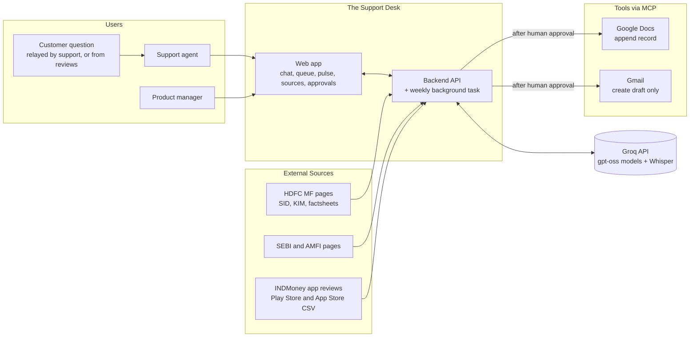

---

### 2.1 Who uses the app

**Every view is internal and behind a login.** Customers never see a reply straight from the system. The chat view is an agent-assist console: a support agent types or speaks the customer's question, for example during a phone call or while handling a ticket, and gets reviewed drafts back. A reply reaches the customer only through an approved action, such as a Gmail draft the agent sends manually. This keeps the problem statement's rule that nothing leaves without a human approving it, while still answering voice questions conversationally.

---

## 3. High-Level Architecture

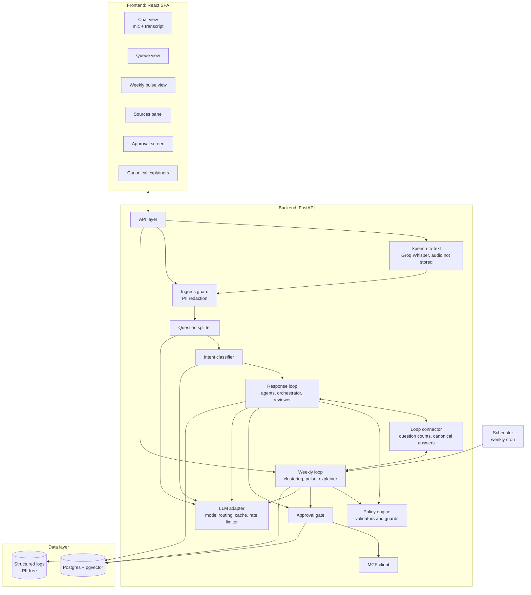

---

## 4. Technology Choices

| Layer | Choice | Why |
|---|---|---|
| **Frontend** | React with Vite and TypeScript, Tailwind CSS | Fast to build six views. Easy static hosting. |
| **Backend** | Python 3.12 with FastAPI | Native async, so the three agents run with `asyncio.gather`. Python has the best tooling for embeddings and clustering. |
| **Database** | Postgres 16 with pgvector | One store for corpus vectors, queue state, themes, approvals and audit records. Transactions make the "one approval, one action" rule enforceable. |
| **Embeddings** | `BAAI/bge-small-en-v1.5` via **fastembed** (ONNX runtime, no PyTorch), with bge's query instruction prefix | Free and runs locally. Uses roughly 150–250 MB of memory, against well over 1 GB for the PyTorch-based sentence-transformers. Groq does not offer embeddings, so this stays local. |
| **LLM** | **Groq API** behind an adapter. OpenAI's open-weight gpt-oss models: the 120B model for drafting and the 20B model for classification. Both are reasoning models, run at low reasoning effort. See section 4.1. | Free tier, very fast inference and an OpenAI-compatible API, so the adapter is a thin wrapper around the `openai` Python client. |
| **Speech-to-text** | **Groq-hosted Whisper** (`whisper-large-v3-turbo`) | Free tier and very fast. Needs no server memory, unlike self-hosting Whisper. The browser Web Speech API is a fallback for local development only. |
| **Text-to-speech** | Browser `speechSynthesis` | No server round trip and no audio stored. |
| **Clustering** | PCA to reduce dimensions, then KMeans with k chosen by silhouette score, capped at 5. Both from scikit-learn. | Deterministic with a fixed seed, so weekly runs are reproducible. PCA is light and starts instantly, unlike UMAP, which compiles code on first use. That matters on a free tier that sleeps. |
| **PII detection** | Regex validators plus the small spaCy model (`en_core_web_sm`) for person names, used directly | Regex is exact for Indian ID formats. spaCy catches names in free text and uses about 50 MB. Presidio was planned first, but it wraps the same model, adds dependencies, and one of them downloads data on first use, which breaks offline CI. |
| **Scheduler** | **GitHub Actions cron** calls the protected trigger endpoint every Monday. A manual trigger button is also in the UI. | Free. It also wakes the sleeping free-tier service. An in-process scheduler would never fire while the service is asleep. |
| **MCP tools** | **The existing Google Docs and Gmail MCP server** built in an earlier milestone, reused as-is | Already built and tested. The backend's allow-list exposes only the doc-append and create-draft tools, and the Google token is limited to Docs and Gmail compose. |
| **Database hosting** | **Neon** free tier (Postgres with pgvector). Supabase free tier is an equal alternative. | Free, supports pgvector and doesn't expire. Render's free Postgres is deleted after a fixed period, so it isn't used. |
| **Deployment** | Docker Compose locally. **Render free web service** for the backend. **Vercel free tier** for the frontend. | All free. The weekly loop runs inside the web service as a background task, because Render's free tier has no separate worker. |
| **Evals** | pytest plus a custom eval runner that writes JSON and Markdown reports | The evals run in CI and from the command line. |

### 4.1 Groq models and free-tier optimisation

**Model routing**

| Task | Model tier | Example model | Why |
|---|---|---|---|
| Intent classification | Small | `openai/gpt-oss-20b` | High volume and simple. Faster and lighter than the large model. |
| Question splitting (only when code rules are unsure) | Small | `openai/gpt-oss-20b` | Returns a JSON list of sub-questions with shared slots. |
| Free-text refinement classification | Small | `openai/gpt-oss-20b` | Picks one of four labels. |
| Theme labelling | Small | `openai/gpt-oss-20b` | Short labels from example reviews. |
| Facts Agent answer extraction | Large | `openai/gpt-oss-120b` | Must stay strictly inside the retrieved text. |
| Orchestrator drafting | Large | `openai/gpt-oss-120b` | Needs careful, short, compliant wording. |
| Reviewer advice judge | Large | `openai/gpt-oss-120b` | Second opinion on subtle advice phrasing. |
| Weekly pulse and fee explainer | Large | `openai/gpt-oss-120b` | Runs once a week, so volume is low. |
| Speech-to-text | Whisper | `whisper-large-v3-turbo` | Fast and free. |

Model names are set in configuration, not in code. Groq changes its model list often. The Llama models first planned here were retired before Phase 0, and the config switched to gpt-oss without code changes.

**Reasoning models.** The gpt-oss models think before answering, and those thinking tokens count toward the reply's token budget. The adapter sends `reasoning_effort=low`, never gives a call fewer than 64 tokens, and treats an empty reply as a failure that is never cached.

**Free-tier limits on this key** (checked November 2026): **1,000 requests per day** and 8,000 tokens per minute for each model. At about 4 calls per question, that is roughly 250 questions per day per model, before caching. The daily cap is the tighter constraint, so caching and code-first decisions matter most.

**Calls that never use a model**

The Pattern Agent's counts and labels, routing rules, PII redaction, length caps, citation checks, keyword refusals and quote selection checks are all code. The Compliance Agent is code-first and calls a model only when the keyword and regex checks are inconclusive.

**Typical model calls per question**

| Path | Calls |
|---|---|
| Advice or returns refusal caught by keyword pre-rules | 0 (template reply) |
| Canonical explainer reuse | 1–2 (intent, orchestrator trims bullets) |
| Full factual pipeline, passes review first time | 4 (intent, Facts, orchestrator, reviewer judge) |
| Full pipeline with one rework | 6 |
| Multi-question message | 0–1 for splitting, then the calls above for each part. A 3-part message costs about 12. |

**Rate-limit handling in the LLM adapter**
- **Token-bucket limiter.** The adapter tracks requests and tokens per minute for each model, using the limits from configuration, and queues calls before they would be rejected.
- **Retry with backoff.** On a rate-limit error, the adapter waits for the time given in Groq's `retry-after` header, with up to 3 retries, then fails closed and marks the item "temporarily unavailable".
- **Fallback model.** If the large model's daily quota is used up, drafting can drop to the small model. The policy validators still run, so the quality drop can't produce an unsafe reply. The draft shows a "fallback model" tag.
- **Response cache.** Calls are cached in Postgres, keyed by a hash of the model, prompt and input. Repeated questions and repeated eval runs cost nothing. Cached text is already redacted, because model inputs are always post-redaction.
- **JSON mode.** Structured outputs use Groq's JSON response format plus Pydantic validation. One repair retry is allowed, then the call fails closed.
- **Short prompts.** Facts Agent prompts include only the top 3 to 4 retrieved chunks, not whole documents. This keeps token use within the per-minute limits.

---

## 5. Ingestion and Corpus

### 5.1 Corpus pipeline (runs once, then on refresh)

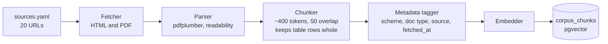

- **`sources.yaml`** is the single source list. Each entry has a URL, a publisher (HDFC MF, SEBI, AMFI or INDMoney help), a document type, and the schemes it covers. The README source list is generated from this file.
- **Allow-list.** The fetcher refuses any domain not on the allow-list: `hdfcfund.com`, `sebi.gov.in`, `amfiindia.com`, and the INDMoney help-centre domain. This enforces "public sources only" in code.
- **Polite, honest fetching.** The fetcher respects robots.txt, identifies itself with an honest user agent, waits a second between requests to a host, and caches downloads. It verifies certificates against the operating system's trust store, because several SEBI and AMFI hosts don't verify against Python's bundled certificates.
- **Manual sources.** hdfcfund.com and indmoney.com block automated requests. The pipeline does not try to get around that. HDFC documents are downloaded by hand and recorded with their real URL, and a manual source is skipped until both its file and its URL are present. HDFC's Statement of Additional Information is fetched automatically from AMFI's portal, which hosts it.
- **Parsing.** Two-column PDF pages are detected by finding the vertical gap that no words cross, and read one column at a time. Repeated page headers and footers are removed. Numbered FAQ questions become section headings.
- **`fetched_at`** on every chunk becomes the `Last checked` date shown in replies and the sources panel.
- **Scheme tagging** lets retrieval filter by scheme. That prevents "HDFC Mid Cap" questions from being answered with Large Cap facts.
- **INDMoney help pages** are tagged `platform_process`. The Facts Agent may cite them only for in-app process questions, never for scheme facts.

### 5.2 Review ingestion (runs at the start of each weekly loop)

1. Load the reviews CSV with columns `review_id, source, date, rating, text`.
2. Pass every row through the **ingress guard**, which redacts PII before the row is written to the database.
3. Drop rows outside the configured window, for example the last 10 weeks. Record the window start and end on the run.
4. Deduplicate by text similarity, and store the result in the `review` table.
5. The stored ids become the run's review set. Later stages use exactly these ids, never "every review in the window", so another CSV or an older run can't leak in. Ingest never deletes rows, so older runs' themes keep their provenance.

---

## 6. Ingress Guard and Policy Engine

This is the code-level enforcement layer. It is plain Python with no LLM in the decision path, so its behaviour is deterministic and testable.

### 6.1 Ingress guard (runs first on every input)

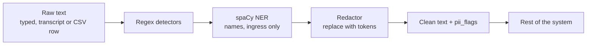

| PII type | Detector |
|---|---|
| PAN | `[A-Z]{5}[0-9]{4}[A-Z]`, case-insensitive, allowing spaces |
| Aadhaar | 12 digits, optionally grouped 4-4-4, plus a Verhoeff checksum to cut false positives |
| Phone | Indian mobile numbers: optional `+91` or `0`, then 10 digits starting with 6–9 |
| Email and UPI id | RFC-style email pattern, plus a UPI id pattern |
| Account or folio number | 9–18 digit sequences near keywords such as "account", "a/c", "folio" |
| OTP | 4–8 digits near keywords such as "OTP", "code", "pin" |

- **Two levels.** Person names are detected and redacted only at ingress. Outgoing drafts, the database write guard and the log filter use only the structured detectors, because corpus facts can legitimately name a fund manager. Every decision and known false positive is listed in [guardrails.md](guardrails.md).
- Redaction replaces the value with a typed token such as `[PAN_REDACTED]`. The original value is **never stored**, not even hashed.
- The guard returns `pii_flags`, a list of which types were found. The Compliance Agent and the routing note use these flags.
- **Human-entered text goes through the guard too.** That covers draft edits, refinement feedback and corrected transcripts, not only customer messages. A support agent pasting a customer's PAN into an edit is redacted the same way.
- Spoken numbers are normalised before detection. For example, "nine eight seven six…" becomes digits, so spoken PII is caught too.

### 6.2 Policy engine (runs on every outgoing artefact)

| Validator | Applies to | Rule |
|---|---|---|
| `citation_required` | Reply drafts, explainer | Every sentence classed as factual must link to a chunk id that exists in the corpus. The URL must be on the allow-list. |
| `advice_guard` | All outgoing text | Blocks phrases such as "you should", "we recommend", "consider investing", "better to", "good time to", and buy, sell, hold or switch suggestions. A small classifier backs up the keyword list. |
| `returns_guard` | All outgoing text | Blocks percentages next to words like return, CAGR, gain, growth or performance, and any future-tense return statement. Expense ratio and exit load percentages are allowed, because those words don't trigger it. |
| `pii_guard` | All outgoing text and all stored text | Re-runs the ingress detectors. Any hit is a hard fail. |
| `length_caps` | Reply, pulse, explainer | Reply at most 3 sentences. Pulse at most 250 words. Explainer at most 6 bullets. |
| `last_checked_present` | Reply, explainer | A `Last checked: <date>` line is required. |
| `explainer_sources` | Explainer | Exactly 2 official source links. |
| `theme_provenance` | Themes, counts | Every theme lists review ids. Every count has a window start and end. |

Validators return structured results, `{rule, passed, detail}`. The reviewer, the approval gate and the evals all use the same validators. That keeps the behaviour tested in evals identical to the behaviour in production.

### 6.3 PII-safe logging

- The logger has a filter that runs `pii_guard` on every log record before writing it. Any hit is redacted and counted in a `pii_log_redactions` metric. A non-zero count in tests fails the build.
- Logs record ids, intents, agent names, timings and validator results. They never record raw user text.
- Agent state stored in Postgres contains only post-redaction text.

---

## 7. The Response Loop

### 7.1 End-to-end flow

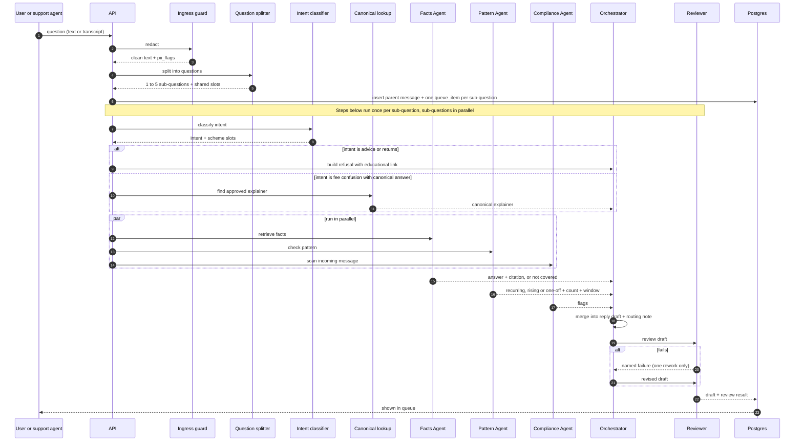

Refusals still run the Pattern Agent. A spike in advice questions is useful product signal.

A single-question message is just the case where the splitter returns one part. There is one code path, not two.

### 7.2 Question splitter

Users often pack several questions into one message:

```
What's the exit load on HDFC Liquid Fund, what's the ELSS lock-in, and should I redeem now?
```

Without splitting, this gets one intent label, one citation and a 3-sentence reply. The facts get refused or the advice request slips through, and one answer ships without its source. The splitter turns it into three independent questions.

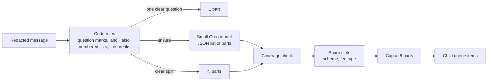

**Steps**
1. **Code rules first.** Split on question marks, numbered or bulleted lists, line breaks, and joining words such as "and", "also" and "plus" when both sides contain a question word or verb. Most messages are settled here with no model call.
2. **Model only when unsure.** For example, "exit load and expense ratio for liquid fund" could be one question or two. The small model returns a JSON list of parts.
3. **Coverage check.** Every part must be built from words in the original message, and together the parts must cover the message's question content. If a part adds content that isn't in the original, the split is rejected and the message is treated as a single question. The model can split the text but cannot add to it.
4. **Share slots.** A scheme or fee named once applies to every part that lacks its own. "What's the exit load and expense ratio of HDFC Liquid Fund?" becomes two parts, both about HDFC Liquid Fund. Pronouns such as "it" and "that one" resolve to the nearest named scheme.
5. **Cap at 5 parts.** Parts beyond the fifth are not processed. The response says "Please ask the remaining questions separately" and lists them. This protects the Groq free-tier limits.
6. **Deduplicate.** Two parts asking the same thing are merged.

**Running the parts**
- Each part becomes a **child queue item** linked to a **parent message**. Each child runs the full pipeline described in section 7.1 on its own: intent, three agents, orchestrator, reviewer, refinement and approval.
- Children run in parallel, limited by the LLM adapter's rate limiter. If the limiter is saturated, children queue rather than fail.
- **Mixed intents are expected.** In the example above, two parts get factual answers with their own citations, and the third gets the advice refusal. The sticky `advice_refused` session flag is set by the third part only and does not affect the other two.
- **The 3-sentence cap and one-citation rule apply per part**, not per message.
- **The Pattern Agent counts each part separately**, so "ELSS lock-in" and "exit load" questions in one message both feed their own clusters.

**Showing the answers**
- **Chat view.** The support agent gets one answer block per question, in the original order. Each block shows the question, the reply, its citation and last-checked date, and its own status. A blocked or not-covered part shows that status without hiding the other answers.
- **Spoken reply.** The answers are read in order, each prefixed with a short form of its question, such as "On the ELSS lock-in:".
- **Queue view.** Children appear grouped under their parent message, each with its own draft, flags, routing note and buttons.
- **Approvals stay per part.** Approving one child creates pending actions for that child only. A "send combined reply" action is available once every child is approved or rejected. It creates one email draft holding the approved answers in order, and it needs its own approval like any other action.

### 7.3 Intent classifier

- A small model with a fixed label set returns `intent`, `confidence` and slots, for example `scheme=HDFC Liquid Fund`.
- **Keyword pre-rules run first.** Obvious advice ("should I", "is it good", "which fund") and returns ("how much return", "CAGR") are forced to the refusal intents. The model alone can't override them, so rephrasing can't talk the system out of a refusal.
- If confidence is below a threshold, the intent becomes `unclear` and the system asks one clarifying question.
- **Session memory** stores the last resolved scheme and a sticky `advice_refused` flag, so follow-ups like "and the ELSS one?" resolve correctly and refusals hold across the session. The session scheme fills only a follow-up (a pronoun, or a scheme fact with no scheme named), never an unrelated complaint. After a refusal, soft advice wording ("is it a smart move") counts as advice.

| Intent | Route |
|---|---|
| `factual` | Full pipeline |
| `fee_canonical` | Canonical explainer, plus the Pattern and Compliance agents |
| `advice` | Refusal template with an AMFI or SEBI link, plus the Pattern Agent |
| `returns` | Refusal with a factsheet link, plus the Pattern Agent |
| `out_of_scope` | Facts Agent returns "not covered" with what it searched |
| `complaint` | Full pipeline, with the routing note as the main output |
| `unclear` | One clarifying question, stored as a draft with `source_type = clarification`. It is reviewed like any other draft, so every queue item still ends with a draft. |

### 7.4 Agent contracts

Each agent is an async function with a typed input and output (Pydantic models). Agents receive only the redacted question and the session slots. They never receive another agent's output.

**Facts Agent**
```python
class FactsResult(BaseModel):
    status: Literal["answered", "not_covered"]
    answer: str | None              # facts only, no citations inline
    citation: Citation | None       # chunk_id, url, title, last_checked
    searched: list[SearchTrace]     # queries run, scheme filter, top chunk ids and scores
```
- Hybrid retrieval: candidates are the union of the top vector matches and the top full-text matches, filtered by the scheme slot. Each is scored by cosine similarity, plus a small boost (+0.03 for a top-3 keyword match, +0.015 for top 10). Plain reciprocal rank fusion scored 83% on the retrieval test set because the keyword query matched common words in many chunks. Vector-first scored 100%.
- A cosine similarity below 0.65 means "not covered" without a model call. On the test set, answerable questions scored at least 0.72 and off-topic ones at most 0.60.
- The model cites a passage number, never a URL. Code maps the number to the chunk and its source.
- If the top score is below a threshold, or the model can't answer from the retrieved chunks alone, the result is `not_covered`, with `searched` filled in.
- The prompt forbids general knowledge. A post-check confirms that every number in the answer appears in the cited chunk text. If one doesn't, the result becomes `not_covered`.

**Pattern Agent**
```python
class PatternResult(BaseModel):
    label: Literal["recurring", "rising", "one_off"]
    matched_theme_id: str | None
    review_count: int
    question_count: int
    window_start: date
    window_end: date
    evidence_ids: list[str]         # review ids and queue item ids
```
- Embeds the question and compares it to theme centroids from the latest weekly run and to recent queue items.
- `recurring` means at least 5 similar items in the window. `rising` means this week's count is at least double the previous week's. Otherwise the label is `one_off`.
- Counts are computed in SQL, not by the model.

**Compliance Agent**
```python
class ComplianceResult(BaseModel):
    incoming_flags: list[Flag]      # pii types found, advice-seeking, returns-seeking
    risk_level: Literal["low", "medium", "high"]
    notes: str
```
- Runs on the incoming message during the parallel phase.
- The outgoing draft is checked by the same policy validators inside the reviewer. That satisfies "scans both incoming and outgoing" without making the Compliance Agent depend on the orchestrator's output.

### 7.5 Orchestrator

Inputs are the three agent results, the intent and any canonical explainer. Outputs:

```python
class Draft(BaseModel):
    reply: str                      # ≤ 3 sentences
    citation: Citation | None
    last_checked: date | None
    source_type: Literal["corpus", "canonical_explainer", "refusal", "not_covered", "clarification"]
    routing: RoutingNote

class RoutingNote(BaseModel):
    team: Literal["support_l1", "support_l2_payments", "product", "compliance"]
    priority: Literal["P1", "P2", "P3"]
    reason: str
    disagreement: str | None        # e.g. "Facts answered cleanly, but Pattern shows 40 similar items in 7 days"
```

**Routing rules (deterministic, applied after the model drafts):**

| Condition | Team | Priority |
|---|---|---|
| PII present or high compliance risk | compliance | P1 |
| Pattern `rising` | product | P1 |
| Pattern `recurring`, fee related | support_l2_payments | P2 |
| Pattern `recurring`, not fee related | product | P2 |
| Facts `not_covered` | support_l2_payments | P2 |
| Otherwise | support_l1 | P3 |

The "recurring, not fee related" row was added in Phase 4: without it a recurring product problem fell through to "not covered" and went to payments support. Customer-facing reply text never names an internal team; the routing note does.

**Disagreement rule.** If Facts is `answered` and Pattern is `recurring` or `rising`, the routing note must state the disagreement, and the item is marked "reply and escalate" instead of "reply and close".

### 7.6 Reviewer

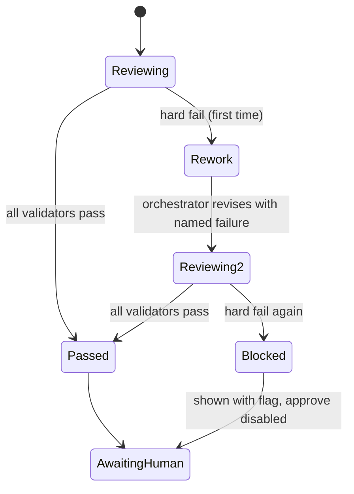

- **Hard fails:** `citation_required`, `advice_guard`, `returns_guard` and `pii_guard`. The length caps and `last_checked_present` are also enforced here.
- An LLM judge adds a second opinion on whether the text "reads as advice". It can only add a failure, never clear one raised by the deterministic validators.
- A `Blocked` draft has the approve and send actions **disabled on the server**, not just hidden in the UI. The API rejects approval of a blocked draft.

### 7.7 Refinement

| Human feedback type | Re-runs | Reuses cached |
|---|---|---|
| Length or tone ("shorter") | Orchestrator, reviewer | Facts, Pattern, Compliance |
| Different scheme | Facts, orchestrator, reviewer | Pattern, Compliance |
| Check against a past theme | Pattern, orchestrator, reviewer | Facts, Compliance |
| Free text | Classified into one of the above by the intent model, with a deterministic fallback to the orchestrator only | |

- Feedback text passes through the ingress guard before it reaches any model or table.
- Each refinement writes a `refinement_event` row with `round`, `feedback_type` and `agents_fired`.
- The API refuses a sixth round.
- Refinement creates a **new draft version** on the same queue item. Earlier versions are kept for the audit trail.

### 7.8 Human decisions

| Action | Effect |
|---|---|
| **Edit** | Runs the human text through the ingress guard, then creates a new draft version. The full policy engine re-runs on it. Edits that fail validation can't be approved. Editing is also the way out of a `Blocked` draft: a corrected version that passes can be approved. |
| **Approve draft** | Accepts the draft and creates two `pending_action` rows for it: a doc append and an email draft. Nothing is written yet. Each action is then approved on its own on the approval screen. |
| **Reject** | Sets that item's status to `rejected`. No other row changes. |

Approving a draft and approving an action are separate steps. The first says the text is right. The second says this specific write to this specific tool may happen.

---

## 8. The Weekly Loop

### 8.1 Pipeline

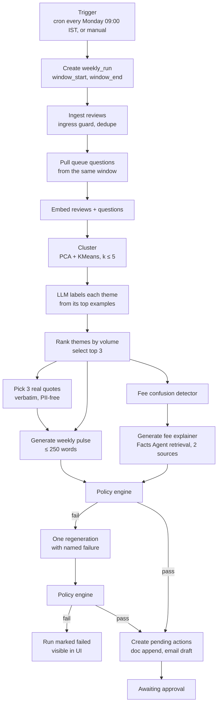

- **No manual steps** between the trigger and "awaiting approval". The run records each stage's status, so the feasibility eval can confirm completion.
- **Resume after restart.** On startup, the app looks for runs left `in_progress` and resumes each from its last finished stage. A free-tier restart in the middle of a run doesn't need a manual re-trigger.
- **Quotes are verbatim.** The system copies them from the stored reviews by id. A check confirms each quote is a substring of its review's text. The model chooses quotes but never writes them.
- **Theme provenance.** Every theme row stores `review_ids`, `question_ids`, `count` and the run's window.
- **Clustering choices.** PCA, k-means++ and the silhouette score are written with numpy, not scikit-learn, to keep the API within the 512 MB free tier. KMeans tries k = 3 to 5, because the pulse needs a top 3 and k = 2 only split praise from complaints on the real sample. Reviews under 8 words are counted but not clustered.
- **Code owns the facts in the pulse.** Counts, the window, quotes and the fee line are written by code. The model writes the summary, one line per theme and the 3 action ideas.

### 8.2 Fee confusion detector

1. Filter themes and items using a fee lexicon: exit load, expense ratio, TER, stamp duty, STT, charges, deducted, "less amount", "cut".
2. Score each fee type by mention count, with extra weight for low-rated reviews.
3. Pick the top fee type. Store the evidence review ids.
4. If no fee type passes the minimum count, the pulse says no fee confusion was detected this week and no explainer is generated. The system never invents one.

The expected outcome for INDMoney is **exit load on early redemption**. The detector confirms or rejects that from the data.

Fee types come in two kinds. **Mutual fund fees** (exit load, expense ratio and Direct vs Regular plans, stamp duty, STT) are covered by the corpus and can get an explainer. **Platform charges** (brokerage, currency conversion, other or hidden charges) are INDMoney's own pricing, which the corpus does not cover: they are counted and reported in the pulse, but never get an explainer. Generic words like "deducted" or "less amount" count as exit load only when the same review talks about redeeming a mutual fund.

**Result on the November 2026 sample:** the exit load hypothesis is rejected. No review mentions exit load. The mutual fund fee issue is Direct vs Regular plans (3 reviews), while most charge complaints are about brokerage and other platform charges.

### 8.3 Fee explainer

- Retrieved through the Facts Agent's retriever, filtered to fee documents across all 5 schemes and the AMFI and SEBI explainers.
- The output holds 6 bullets at most, 2 source links and a `Last checked` date, all checked by validators.
- Factsheets are left out of its search (their chunks are mostly performance tables), and no source supplies more than 3 of the 6 passages, so two sources are always available to cite. Every bullet cites a passage, and its numbers must appear in that passage.
- After the weekly actions, it can become a **canonical explainer** through its own approval (see section 9).

---

## 9. Connecting the Two Loops

This is the core new work, so it has its own module, `loop_connector`.

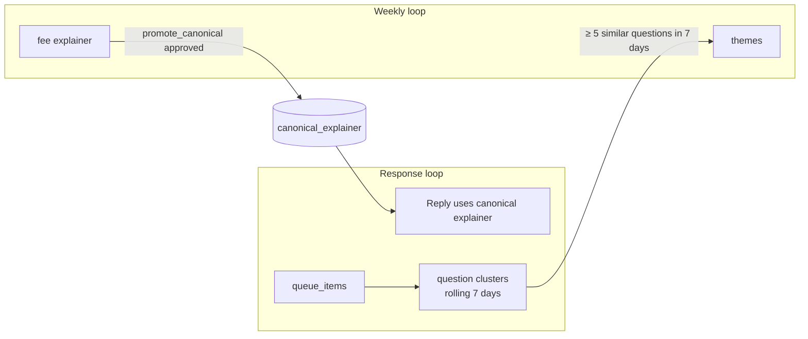

### 9.1 Response loop to weekly loop

- Each new queue item is embedded and assigned to a **rolling question cluster** with a similarity threshold.
- When a cluster reaches **5 or more items within 7 days**, it is marked `surfaced`. The next weekly run must include it as a theme or as the key observation, with its count, window and queue item ids.
- The pulse view shows these with a "from support queue" tag, so product can see what support is being asked.
- **Reported once, then while active.** A surfaced cluster is reported by the first weekly run that ends after it surfaced. Later runs report it again only while it is still active (5 new items in the run's last 7 days). The pulse lists each one as `label (N questions, first to last date)`, written by code; a check fails the pulse if any surfaced cluster is missing from it.

### 9.2 Weekly loop to response loop

- Each weekly run with a fee explainer creates a third pending action, `promote_canonical`. It is internal, with no MCP call. Approving it writes the explainer to `canonical_explainer` with its fee type, embedding, sources, `approved_at` and `approved_by`.
- Promotion is a separate approval on purpose. Approving the doc append must not change how the response loop answers customers. That would be one approval triggering another effect, which the problem statement forbids.
- On a `fee_canonical` intent, or when a question's embedding is close to a canonical explainer, the orchestrator **builds the reply from the explainer**. It takes the 1–3 most relevant bullets and keeps the explainer's citation.
- The draft's `source_type` is `canonical_explainer`, and the UI shows a "Canonical answer" badge linking to the explainer.
- A newer approved explainer for the same fee type replaces the older one, which is archived.
- **Matching rules.** A question that names a fee type only ever uses that fee type's explainer. A factual question or complaint that names a scheme never uses one: the scheme's own documents answer it. Thresholds are in `config.py`, calibrated on the real explainer.
- **The reply is the bullets themselves.** Code picks the 1–3 bullets nearest the question, all from one source, and cites the corpus chunk they came from. No model rewords them, so a refinement asking for different wording leaves them unchanged; a person edits the draft instead.
- **Reuse count.** Each queue item whose reply was built from an explainer adds one, once per item.

---

## 10. Approval Gate and MCP

### 10.1 Pending action model

```python
class PendingAction(BaseModel):
    id: UUID
    kind: Literal["doc_append", "email_draft", "promote_canonical"]
    origin: Literal["weekly_run", "queue_item", "message"]
    origin_id: UUID
    target: str                     # Google Doc id, Gmail account label, or "internal" for promote_canonical
    payload: dict                   # exactly what will be written
    payload_hash: str               # sha256 of the canonical JSON payload
    status: Literal["pending", "approved", "executed", "rejected", "failed"]
```

### 10.2 Gate flow

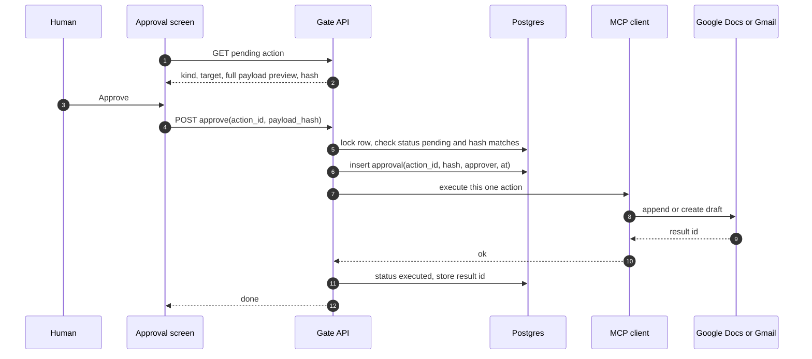

**Guarantees and how they are enforced:**

| Guarantee | Mechanism |
|---|---|
| Internal actions follow the same rule | `promote_canonical` goes through the same approve endpoint, hash check and approval row. It just writes to the database instead of calling a tool. |
| Nothing is written without approval | The MCP client's `execute()` takes an `approval_id` and re-checks it in the database before calling any tool. There is no other code path to the tools. |
| The human sees exactly what is written | The approval request must include `payload_hash`. If the payload changed after the preview, the hashes differ and the approval is rejected. |
| One approval, one action | An approval row references one action id, with a unique constraint. Approving the doc append does not approve the email draft. Each needs its own click. |
| No auto-send | The Gmail MCP tool list is filtered to `create_draft`. `send` is never registered with the client. |
| Idempotent execution | A row lock plus a status check stops double execution if someone clicks twice. |

### 10.3 Payloads

- **Doc append** uses the Milestone 2 record: `date, top_themes, weekly_pulse, identified_fee_issue, explanation_bullets, source_links`. Queue approvals append `date, question, reply, citation, routing`.
- **Email draft** uses the subject `Weekly Product Pulse + Customer Clarification — <date>`. The body holds the pulse plus the explainer as a support snippet. Queue approvals create a reply draft for the support agent to send manually. **The draft has no recipient.** The system never stores customer email addresses, so the agent adds the recipient in Gmail before sending.

---

## 11. Voice Pipeline

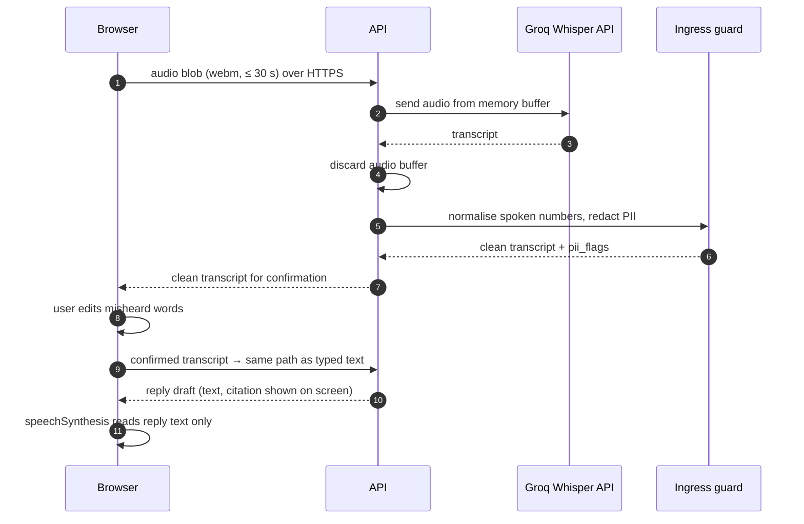

- **Raw audio is never stored by this system.** The upload handler reads into memory, forwards the buffer to Groq and drops it. Request-body logging is disabled for the audio endpoint.
- **Audio does leave the server.** Groq receives the raw audio to transcribe it, so spoken PII reaches Groq before redaction. This is an accepted trade-off for a free, fast service that needs no server memory. Check Groq's data retention policy before deployment and record it in the README.
- **Audio limits.** Clips are capped at 30 seconds to stay well inside Groq's file-size and audio-time limits on the free tier.
- **The transcript is redacted before the user sees it.** That way PII is never even echoed back.
- **Scheme name hints.** The five scheme names and fee terms are passed in the Groq Whisper `prompt` parameter. After transcription, fuzzy matching maps near-misses to the correct scheme name. The user still confirms.
- **Spoken replies** read only the reply text. The citation and `Last checked` date stay on screen.

---

## 12. Data Model

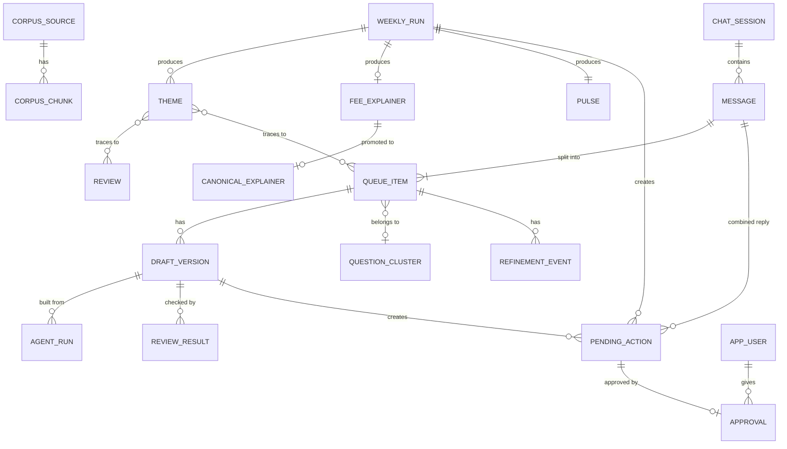

| Table | Key fields |
|---|---|
| `corpus_source` | id, url, publisher, doc_type, schemes[], fetched_at |
| `corpus_chunk` | id, source_id, text, embedding, scheme, section |
| `review` | review_id, source, date, rating, text_redacted, pii_flags |
| `weekly_run` | id, window_start, window_end, status, stage_log, triggered_by |
| `theme` | id, run_id, label, count, centroid, review_ids[], question_ids[], rank, from_support_queue, cluster_id (the surfaced question cluster a support-queue theme reports) |
| `pulse` | id, run_id, text_redacted, word_count, quote_review_ids[] |
| `fee_explainer` | id, run_id, fee_type, bullets[], source_urls[], last_checked, evidence_review_ids[], chunk_ids[] (the corpus chunk behind each bullet) |
| `canonical_explainer` | id, fee_type, explainer_id, embedding, approved_at, approved_by, active, archived_at, bullet_chunk_ids[], reuse_count |
| `chat_session` | id, user_id, last_scheme, advice_refused, created_at, expires_at |
| `message` | id, session_id, channel (text, voice, csv), text_redacted, pii_flags, split_method (rules, model, single), parts_dropped |
| `queue_item` | id, message_id, part_index, text_redacted, shared_slots, intent, status, cluster_id |
| `question_cluster` | id, centroid, first_seen, last_seen, surfaced, surfaced_at. Members are found through `queue_item.cluster_id`. |
| `draft_version` | id, item_id, version, reply_redacted, citation, last_checked, source_type, canonical_id (set for canonical answers), routing, author (system or human), author_id, model_tag, review_status |
| `agent_run` | id, item_id, draft_version_id (empty until a draft exists), agent, status, output_json, started_at, finished_at, latency_ms |
| `review_result` | id, draft_version_id, attempt, rule_results[] |
| `refinement_event` | id, item_id, round, feedback_type, agents_fired[] |
| `pending_action` | id, kind, origin, origin_id, target, payload, payload_hash, status, result_id |
| `approval` | id, action_id (unique), payload_hash, approver_id, at |
| `app_user` | id, username, password_hash, role |
| `llm_cache` | key (hash of model, prompt and parameters), model, response_text, prompt_tokens, completion_tokens, created_at |

Every column holding user-originated free text ends in `_redacted`, so the write guard can find it. No table has a column that can hold raw user text. Every text column is written only from the output of the ingress guard, and a database-layer test confirms it.

---

## 13. API Surface

| Method and path | Purpose |
|---|---|
| `POST /chat/message` | Typed message into the conversational view. Returns one answer block per question, in order. |
| `POST /chat/voice` | Audio upload. Returns the redacted transcript for confirmation. |
| `GET /queue` | Queue items with their latest draft, flags and routing |
| `POST /queue/import-csv` | Pull questions from the reviews CSV |
| `POST /queue/{id}/refine` | Refinement feedback. Returns the new draft version and the agents that fired. |
| `PUT /queue/{id}/draft` | Human edit. Creates a new version and re-validates it. |
| `POST /queue/{id}/approve` | Creates the pending actions for this draft |
| `POST /queue/{id}/reject` | Rejects this item only |
| `POST /messages/{id}/combined-reply` | Creates one pending email-draft action holding all approved answers for a multi-question message |
| `POST /weekly/run` | Manual trigger for the weekly loop |
| `GET /weekly/{run_id}` | Themes, counts, windows, quotes, pulse, explainer, and the run status the cron job polls |
| `GET /sources` | Corpus sources with last-checked dates, and claims linked to them |
| `GET /explainers/canonical` | Active canonical explainers with sources and reuse count (`?include_archived=true` adds replaced ones) |
| `GET /actions/pending` | Approval screen data |
| `POST /actions/{id}/approve` | Approves and executes **one** action. Requires `payload_hash`. |
| `POST /actions/{id}/reject` | Rejects one action |

---

## 14. Frontend Views

| View | Backed by | Notes |
|---|---|---|
| Chat | `/chat/*` | Mic button, editable transcript, one answer block per question with its own citation chip and status, play button for the spoken reply, disclaimer banner |
| Queue | `/queue*` | Table with channel, intent, status, pattern badge and flags. Questions from one message are grouped under it. A detail drawer shows the draft history, agent outputs, reviewer results and refinement log. |
| Weekly pulse | `/weekly/*` | Theme cards with counts and windows. Clicking a count lists the review ids. A "from support queue" tag marks surfaced clusters. |
| Sources | `/sources` | Each source with its publisher, last-checked date and the drafts that cite it |
| Approvals | `/actions/*` | One card per action showing the kind, target and full payload, with separate approve buttons |
| Canonical explainers | `/explainers/canonical` | Active explainers with their sources and reuse count |

---

## 15. Evaluation Harness

Evals run against the **assembled system** through the public API, using a test database seeded from fixtures.

```
evals/
  datasets/
    intents_labelled.jsonl        # ≥ 30 questions across 7 intents
    adversarial.jsonl             # advice, returns, PII, rephrased and repeated
    not_covered.jsonl             # questions the corpus can't answer
    complaints_20.jsonl           # 20 real complaints from the CSV
    multi_question.jsonl          # multi-part messages with expected parts and intents
    voice/                        # 10 recorded questions + expected transcripts
  test_feasibility.py
  test_edit_correctness.py
  test_grounding_compliance.py
  test_voice_intent.py
  test_loop_connection.py
  test_multi_question.py
  run_all.py                      # writes evals/results/<date>.md and .json
```

| Suite | What it does | Pass condition |
|---|---|---|
| **Feasibility** | Runs every queue item and a full weekly run | Every item has a draft or "not covered". Every theme has review ids and a window. Pulse ≤ 250 words. Explainer ≤ 6 bullets. The run completes with no manual step. |
| **Edit correctness** | Snapshots every table, performs one edit, approval or rejection, then diffs | Only the expected rows change. Approving one action leaves the other pending. |
| **Grounding and compliance** | Samples 15 claims. Runs the adversarial set through both loops, typed and spoken. Greps logs and the database. | Every claim resolves to a chunk or review id. Every adversarial item is refused or redacted. Zero PII matches in logs or stored state. |
| **Voice and intent** | Labelled intent set, voice parity set, spoken PII | Intent accuracy reported with a confusion table. Voice and typed versions match. Spoken PII is redacted. |
| **Multi-question** | Runs at least 15 multi-part messages, including mixed factual and advice parts, shared scheme slots, more than 5 parts, and PII in one part only. Some are spoken. | Each expected part is found and answered separately with its own citation. Advice parts are refused while factual parts are answered. Shared slots carry over. Parts beyond 5 are listed, not processed. Rejecting one part leaves its siblings untouched. |
| **Loop connection** | Seeds 5 similar questions, runs the weekly loop, approves the explainer, asks a related question | The cluster appears in the pulse. The next reply has `source_type = canonical_explainer`. |

The results file is committed to the repo for the submission. CI runs the deterministic suites on every push. LLM-dependent suites run on demand.

---

## 16. Observability

- **Structured JSON logs** with a request id, item id, agent, latency, validator results and token counts. They never contain user text.
- **Agent trace view** in the queue detail drawer, built from `agent_run` rows. It shows that the three agents started together and how long each took. This is the evidence for "three agents run in parallel".
- **Metrics:** drafts by status, reviewer fail rate by rule, not-covered rate, refusal rate, pending approvals and PII redaction counts.

---

## 17. Deployment

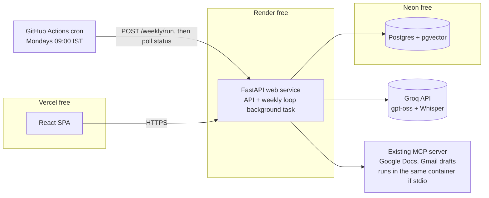

- **Secrets** are kept in the platform's environment variables: Groq API key, Google OAuth credentials, the database URL and a trigger token for the cron endpoint. The GitHub Actions workflow holds only the trigger token. The Google OAuth scopes are limited to Docs editing and Gmail **compose** only.
- **Auth.** A simple login protects **every view**, including chat, because the chat is an internal console (section 2.1). Approvals record the approver's account.
- **Corpus refresh** is a manual command that re-fetches sources and updates `fetched_at`.
- **Free-tier sleep.** Render's free web service sleeps after a period of inactivity and takes up to about a minute to wake. The cron call wakes it for the weekly run. Render decides sleep from incoming requests, and a background task doesn't count, so the cron job **polls the run status every minute until it finishes**. That keeps the service awake during the run and makes a failed run show up as a failed GitHub Actions job. Before a demo, open the app once to warm it up. The weekly loop runs as a background task, and progress is saved per stage, so a restart resumes rather than repeats.
- **Memory budget.** Render's free tier gives about 512 MB. Expected use is FastAPI and libraries at about 150 MB, fastembed at about 200 MB and the small spaCy model at about 50 MB. That leaves headroom. No local speech or language models run on the server.
- **Local development:** `docker compose up` starts Postgres with pgvector, the API and the frontend. Only the Groq API key is needed. A seed script loads the corpus and a sample reviews CSV.

---

## 18. Repository Layout

```
grad-proj/
  docs/
    problemstatement.md
    architecture.md
  backend/
    app/
      api/                 # FastAPI routers
      guard/               # ingress guard, PII detectors
      policy/              # validators shared by reviewer, gate and evals
      intent/              # classifier, pre-rules, session memory
      agents/              # facts.py, pattern.py, compliance.py
      orchestrator/        # merge, routing rules, refinement
      reviewer/
      weekly/              # ingest, cluster, pulse, fee detector, explainer
      connector/           # loop_connector
      gate/                # pending actions, approvals
      mcp/                 # MCP client, tool allow-list, payload-to-tool mapping
      voice/               # Groq Whisper client, number normalisation
      llm/                 # Groq adapter, model routing, rate limiter, cache
      db/                  # models, migrations
    corpus/
      sources.yaml
      ingest.py
    tests/
  mcp_server/              # existing Google Docs and Gmail MCP server (folder or git submodule)
  frontend/
    src/views/             # Chat, Queue, Pulse, Sources, Approvals, Canonical
  evals/
  data/
    reviews_sample.csv     # PII removed
  samples/                 # 5 sample Q&A, doc entry, email draft
  .github/workflows/
    weekly.yml             # cron trigger for the weekly loop
  docker-compose.yml
  README.md
```

---

## 19. Key Design Decisions

| Decision | Alternative considered | Why this way |
|---|---|---|
| Deterministic validators decide. The LLM judge can only add failures. | An LLM as the sole reviewer | An LLM reviewer can be persuaded and is not reproducible. A compliance team can read and audit regex rules and keyword lists. |
| Redact at ingress, store only redacted text | Store raw text, redact on display | Raw text in the database means raw text in backups, logs and agent state. Redacting at the door removes the whole class of leaks. |
| Compliance Agent scans the incoming message. The reviewer's validators scan the outgoing draft. | Compliance Agent waits for the draft | Keeps the three agents truly parallel and independent, as the brief requires. |
| Split multi-question messages into independent parts | Answer the whole message in one draft | Keeps one intent, one citation and one 3-sentence cap per question. Stops an advice part from blocking or contaminating the factual parts. |
| Approval bound to a payload hash | Approval bound to an action id only | Stops a payload changing between preview and execution. |
| Groq-hosted Whisper | Self-hosted Whisper | Free and fast, and needs no server memory. Self-hosting doesn't fit in a 512 MB free tier. The cost is that raw audio reaches Groq before redaction. |
| Groq with gpt-oss models | Paid frontier models | Free. Open-weight models follow strict instructions less reliably than top paid models, but the code-level validators catch rule breaks, so safety doesn't depend on the model obeying. |
| fastembed (ONNX) | sentence-transformers (PyTorch) | Same embedding model at a fraction of the memory. |
| GitHub Actions cron | In-process scheduler | An in-process scheduler can't fire while a free service sleeps. |
| Postgres for everything | A separate vector database plus Postgres | One transactional store makes state diffs for the edit-correctness eval simple. |
| Counts computed in SQL | Counts reported by the model | Models miscount. Counts have to be exact and carry a window. |
| Quotes copied by review id | Model writes quotes | Guarantees quotes are real and traceable. |

---

## 20. Known Limits

- **Conflicting official sources.** SEBI's riskometer page describes five risk categories, while SEBI's mutual fund FAQ lists six, including Very High. The system cites whichever passage it retrieves.
- **Corpus coverage** is limited to 5 HDFC schemes and about 20 pages. Questions about other AMCs or schemes return "not covered".
- **Scheme documents go stale.** `Last checked` dates are shown, but the system doesn't re-fetch automatically between manual refreshes.
- **Keyword guards** can block legitimate phrasing, such as "you should receive your statement by email". The false positive rate is tracked in the evals, and the reviewer flag shows which rule fired.
- **Groq free-tier limits** cap requests and tokens per minute and per day. A full eval run can hit the daily cap. Caching and the fallback model reduce this. Run large eval suites on separate days if needed.
- **The gpt-oss models** sometimes break length caps or slip into advice phrasing. The reviewer catches these, but they raise the rework rate and use more calls.
- **Spoken PII reaches Groq.** Audio is sent to Groq before redaction. The system never stores audio or unredacted transcripts.
- **Whisper accuracy** on Indian-accented speech and fund names is imperfect. Transcript confirmation and fuzzy scheme matching reduce this but don't remove it.
- **Question splitting** can misjudge tightly linked questions, such as "what's the exit load and why was I charged it?". The coverage check prevents invented questions but not every wrong split. The support agent can see each part and its parent message in the queue.
- **Clustering at k ≤ 5** can merge distinct issues on a small review set. Theme provenance lets a human check.
- **The chat is not customer-facing.** Customers get answers only through drafts a support agent sends. A self-service customer chat would need its own approval design.
- **Free hosting tiers** cold-start after sleeping, so the first request can take up to about a minute.
