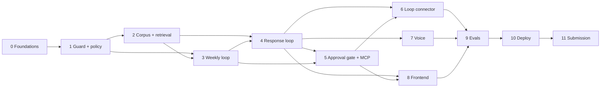

# Implementation Plan: The Support Desk

> Phase-wise build plan for the system in [architecture.md](architecture.md), meeting the requirements in [problemstatement.md](problemstatement.md).
> Stack: FastAPI, Postgres with pgvector on Neon, Groq (gpt-oss and Whisper), fastembed, React with Vite, Render and Vercel. Cost target: ₹0.

---

## How to use this plan

- **Phases are ordered by dependency.** Each phase ends with an **exit check**, a short list of things that must be true before moving on. Don't start a phase until the previous exit check passes.
- **The code-level safety pieces come first.** The ingress guard and policy engine are built and tested before any model call exists. Every later phase plugs into them, so safety is never retrofitted.
- **Every phase adds tests.** Deterministic tests run in CI from Phase 0. Tests that call Groq are marked and run on demand, so CI never burns the free quota.
- **Effort estimates** assume one person working part-time, about 3 to 4 hours a day. Total is about 6 weeks. Phases 8 and 9 can overlap with earlier phases if time is short.

### Phase overview

| Phase | Name | Main output | Estimate |
|---|---|---|---|
| 0 | Foundations | Repo, config, database, Groq adapter, CI | 2–3 days |
| 1 | Ingress guard and policy engine | PII redaction and all validators, fully tested | 3 days |
| 2 | Corpus and retrieval | 20-page corpus, hybrid retrieval, Facts Agent | 4 days |
| 3 | Weekly loop | Clustering, themes, fee detector, pulse, explainer | 4–5 days |
| 4 | Response loop | Splitter, intent, three agents, orchestrator, reviewer, refinement | 6–7 days |
| 5 | Approval gate and MCP | Pending actions, approvals, and the existing MCP server connected for Google Docs and Gmail drafts | 2–3 days |
| 6 | Loop connector | Question clusters into the pulse, canonical explainers into replies | 2–3 days |
| 7 | Voice | Groq Whisper transcription, transcript confirmation, spoken replies | 2–3 days |
| 8 | Frontend | Six views | 5–6 days |
| 9 | Evaluations | Six eval suites and a results report | 4 days |
| 10 | Deployment and hardening | Live app on free tiers, weekly cron, auth | 2–3 days |
| 11 | Submission | README, samples, eval results, demo | 2 days |

### Dependency graph

Phase 3 needs Phase 2's retriever only for the fee explainer. Clustering can start as soon as Phase 1 is done. The frontend can start after Phase 4 using the real API. Deployment can be tried early, at the end of Phase 2, to catch hosting problems sooner.

---

## Phase 0: Foundations

**Goal:** a running skeleton that every later phase builds on.

### Tasks
- [x] **Repository.** Create the layout from architecture section 18. Initialise git with a Python `.gitignore` and a Node `.gitignore`. Add `.env.example` listing every variable.
- [x] **Python project.** Use `uv` or `poetry` with Python 3.12. Core dependencies: `fastapi`, `uvicorn`, `pydantic`, `pydantic-settings`, `sqlalchemy[asyncio]`, `asyncpg`, `alembic`, `pgvector`, `openai` (for Groq's compatible API), `httpx`, `tenacity`, `structlog`, `pytest`, `pytest-asyncio`.
- [x] **Config.** One `Settings` class loaded from environment variables. It holds the Groq key, database URL, model names per task, rate limits per model, Google credentials and the cron trigger token. Model names live here, never in code.
- [x] **Database.**
  - Create a free Neon project and enable the `vector` extension.
  - Set up a local Postgres with pgvector in `docker-compose.yml` (image `pgvector/pgvector:pg16`).
  - Set up Alembic, and write the first migration with every table from architecture section 12.
  - Add a `text_redacted` naming rule: every user-text column ends in `_redacted`. Phase 1 adds a test that relies on this.
- [x] **Groq adapter skeleton** (`backend/app/llm/`).
  - `LLMClient.complete(task, messages, json_schema=None)` picks the model from config by task name.
  - Uses the `openai` client pointed at Groq's base URL.
  - **Response cache from day one**, stored in a Postgres table keyed by `sha256(model + prompt + input)`. This saves quota during all of development.
  - Token-bucket rate limiter per model, plus retry on rate-limit errors using the `retry-after` header, with at most 3 retries.
  - Records token counts for each call.
- [x] **Logging.** Set up `structlog` for JSON logs with a request id. Add a placeholder for the PII filter, which Phase 1 completes.
- [x] **FastAPI app** with a `/health` endpoint that checks the database and Groq connections.
- [x] **CI.** Add a GitHub Actions workflow running lint (`ruff`), type checks (`mypy` on core modules) and `pytest -m "not llm"`.
- [x] **Test markers.** `@pytest.mark.llm` marks tests that call Groq. CI skips them.

### Exit check
- `docker compose up` starts Postgres and the API, and `/health` returns OK.
- A test call through the adapter returns a Groq response, and a second identical call is served from the cache.
- Migrations apply cleanly to both local Postgres and Neon.
- CI passes on push.

---

## Phase 1: Ingress Guard and Policy Engine

**Goal:** the deterministic enforcement layer, complete and heavily tested before any model writes text.

### Tasks: ingress guard (`backend/app/guard/`)
- [x] **Regex detectors** for each PII type in architecture section 6.1: PAN, Aadhaar with Verhoeff checksum, Indian mobile numbers, email, account or folio numbers near keywords, and OTPs near keywords.
- [x] **Spoken-number normaliser.** Converts "nine eight seven six…" and "double five" into digits before detection. Needed for voice in Phase 7, but built here so the guard is complete.
- [x] **spaCy** `en_core_web_sm`, used directly for person names at ingress only (Presidio dropped, see [guardrails.md](guardrails.md)). Indian ID formats stay with the regex detectors.
- [x] **Redactor.** Replaces each match with a typed token such as `[PAN_REDACTED]`. Returns `(clean_text, pii_flags)`. The original value is never returned, stored or logged.
- [x] **Log filter.** Every log record passes through the detectors before it is written. Each hit increments the `pii_log_redactions` counter.

### Tasks: policy engine (`backend/app/policy/`)
- [x] One validator function per rule in architecture section 6.2. Each returns `RuleResult(rule, passed, detail)`.
  - `citation_required`: every factual sentence links to a chunk id that exists, on an allow-listed domain.
  - `advice_guard`: keyword and phrase list, written as data in a YAML file so it is easy to audit and extend.
  - `returns_guard`: percentages near return words. Must allow expense ratio and exit load percentages.
  - `pii_guard`: re-runs the ingress detectors.
  - `length_caps`: sentence counting must handle abbreviations such as "Rs.", "e.g." and "approx.", and decimals such as "1.5%".
  - `last_checked_present`, `explainer_sources`, `theme_provenance`.
- [x] `run_policy(artifact_type, artifact) -> list[RuleResult]` picks the right validators for each artefact type.
- [x] **Database write guard.** A SQLAlchemy `before_insert` and `before_update` hook runs `pii_guard` on every column ending in `_redacted`. Any hit raises an error, so unredacted text can't be stored even by mistake.

### Tests
- [x] At least 60 PII cases covering valid formats, spaced and dashed formats, lower case, spoken forms, and false-positive traps such as a 12-digit number that fails the Aadhaar checksum, or "SIP of 5000".
- [x] At least 40 advice and returns cases, including subtle phrasing ("staying invested longer may help") and allowed phrasing ("you should receive your statement by email", "exit load is 1%").
- [x] Sentence counter tests with abbreviations and decimals.
- [x] A test that tries to insert a PAN into a `_redacted` column and expects an error.

### Exit check
- All guard and policy tests pass in CI without any network access.
- The advice keyword false-positive cases are documented, with a decision for each: allow, or accept the false positive.

---

## Phase 2: Corpus and Retrieval

**Goal:** the Milestone 1 corpus rebuilt as a clean, tagged, searchable store, and a Facts Agent that answers only from it.

### Tasks: source list
- [x] **Write `backend/corpus/sources.yaml`** with about 20 entries, following the problem statement corpus plan:
  - HDFC Mutual Fund, 12–14 entries. For each of the 5 schemes: the scheme page, KIM or SID, and the latest factsheet. Plus the TER disclosure page, the exit load or charges page, the statement and capital-gains guides, and the investor FAQ.
  - SEBI, 3–4 entries: the investor charter, the riskometer circular, the categorisation circular and the TER rules.
  - AMFI, 3–4 entries: investor education pages on SIP, ELSS, exit load, expense ratio and the riskometer.
  - Each entry holds `url, publisher, doc_type, schemes[]`.
- [x] **Confirm the scheme names** against the current SIDs, as the problem statement asks. Update both documents if any name changed.

### Tasks: ingestion pipeline
- [x] **Fetcher.** Uses `httpx` with a domain allow-list. It refuses any URL outside `hdfcfund.com`, `sebi.gov.in`, `amfiindia.com` and the INDMoney help domain. Raw downloads are cached locally so re-runs don't re-download.
- [x] **Parsers.** `pdfplumber` for PDFs, keeping tables as rows. `readability-lxml` or `trafilatura` for HTML.
- [x] **Chunker.** About 400 tokens with 50 overlap. Never splits a table row. Keeps the section heading in each chunk.
- [x] **Metadata tagger.** Sets scheme, doc type, publisher, section and `fetched_at`. Tags INDMoney pages as `platform_process`.
- [x] **Embedder.** fastembed with `BAAI/bge-small-en-v1.5`. Stores vectors in `corpus_chunk.embedding`.
- [x] **CLI command** `python -m corpus.ingest` loads everything. A `--refresh` flag re-fetches and updates `fetched_at`.

### Tasks: retrieval and Facts Agent (`backend/app/agents/facts.py`)
- [x] **Hybrid retrieval.** Postgres full-text search (BM25-like) plus pgvector cosine similarity, merged with reciprocal rank fusion. Filtered by the scheme slot when one is known. INDMoney chunks are excluded unless the intent is a platform process question.
- [x] **Facts Agent.**
  - Takes the top 3–4 chunks and calls the large Groq model with a strict "answer only from these passages" prompt. Uses JSON mode to return `{answer, chunk_id}` or `{not_covered: true}`.
  - **Number check:** every number in the answer must appear in the cited chunk's text. Otherwise the result becomes `not_covered`.
  - Low retrieval scores give `not_covered` without a model call.
  - Fills `searched` with the queries, filters and top chunk ids for every result.
- [x] **Retrieval test set** of 25 questions with the expected chunk or source, covering all 5 schemes and the common facts: expense ratio, exit load, minimum SIP, lock-in, riskometer, benchmark and statements.

### Status (November 2026)
- **Corpus:** 15 sources, 630 chunks. SEBI (3), AMFI (3), HDFC's Statement of Additional Information from AMFI's portal, and 8 HDFC documents downloaded by hand (5 KIMs, the September 2026 factsheet, the daily TER spreadsheet and the statements guide), each with its exact hdfcfund.com URL.
- **Parsing additions:** `.xlsx` spreadsheets (the TER file: latest date per scheme only), and vertically merged PDF table cells repeated on each row they cover, so factsheet scheme rows keep their values.
- **Scheme names confirmed** against AMFI's scheme master data. AMFI lists the ELSS fund as "HDFC ELSS - Tax Saver Fund", kept as an alias.
- **Retrieval test set:** 26 of 26 questions have a correct source in the top 4.
- **Facts Agent:** 26 of 26 answered with a correct citation, and 5 of 5 off-topic questions returned as "not covered" with search details. The riskometer question expects "not covered": the level is only drawn as an image in the KIM and factsheet.
- **Not done:** the optional early deploy to check memory on Render.

### Exit check
- The corpus loads with 15–25 sources, and every chunk has a scheme tag (or "general") and a `fetched_at` date.
- On the retrieval test set, the correct source is in the top 4 for at least 90% of questions.
- The Facts Agent answers the test set with correct citations, and returns `not_covered` with search details for 5 out-of-scope questions.
- **Optional early deploy:** push the API to Render with Neon, and confirm fastembed fits in the 512 MB memory limit.

---

## Phase 3: Weekly Loop

**Goal:** the Milestone 2 pipeline running end to end with no manual steps, up to "awaiting approval".

### Tasks: reviews data
- [x] **Collect INDMoney reviews** from the last 8–12 weeks of Play Store and App Store reviews, for example with the `google-play-scraper` package and the App Store RSS feed. Save as CSV with `review_id, source, date, rating, text`.
- [x] **Clean the sample.** Run the ingress guard over it and commit only the redacted version as `data/reviews_sample.csv`.

### Tasks: pipeline (`backend/app/weekly/`)
- [x] **Run record.** `weekly_run` with the window and a `stage_log`. Each stage saves its status, so an interrupted run resumes from the last finished stage.
- [x] **Ingest.** Guard, window filter, near-duplicate removal and insert.
- [x] **Cluster.**
  - Embed reviews, plus any queue questions in the window once Phase 4 exists.
  - Reduce dimensions with PCA, then run KMeans for k = 2 to 5 with a fixed seed. Pick k by silhouette score.
  - Store `review_ids` and `count` per theme.
- [x] **Label themes** with the small model, using the 8 reviews closest to each cluster centre. The output is a short label plus a one-line description.
- [x] **Rank** themes by count and mark the top 3.
- [x] **Quotes.** The model picks 3 review ids from the top themes. Code copies the text and checks it is a substring of the stored review. The model never writes quote text.
- [x] **Fee confusion detector.** Fee lexicon scoring as in architecture section 8.2, with a minimum-count threshold. If none qualifies, the run records "no fee confusion this week".
- [x] **Fee explainer.** Retrieves through the Phase 2 retriever, filtered to fee documents. The large model writes at most 6 bullets. Code attaches 2 source links and the `Last checked` date from `fetched_at`.
- [x] **Weekly pulse.** The large model writes it from the top themes, quotes, counts and windows, with at most 250 words and 3 action ideas.
- [x] **Validation.** Run the policy engine on both. On failure, regenerate once with the named failure. On a second failure, mark the run failed and show why.
- [x] **Trigger endpoint.** `POST /weekly/run` runs the loop as a FastAPI background task and returns the run id immediately. It is protected by the trigger token. `GET /weekly/{run_id}` returns the run status for polling.
- [x] **Resume on startup.** A startup hook finds runs left `in_progress` and resumes each from its last finished stage.
- [x] **Pending actions for the run.** A validated run creates a doc append and an email draft action, plus a `promote_canonical` action when it has a fee explainer. The gate that executes them comes in Phase 5.

### Tests
- [x] A fixed fixture CSV gives a reproducible set of clusters, using the fixed seed.
- [x] Every theme has review ids and a window. Every quote is a verbatim substring.
- [x] Pulse and explainer stay within their caps on 3 runs.
- [x] A fixture with no fee mentions produces "no fee confusion" and no explainer.

### Status (November 2026)
- **Review sample:** 1,085 INDMoney reviews from 26 Aug to 17 Nov 2026 (978 Play Store, 107 App Store), collected by `backend/scripts/collect_reviews.py`. Every text goes through the ingress guard before anything is written, so raw text never reached the disk; author names are never read. 124 names redacted, no other PII found. The guard over-redacts some Hindi and Hinglish words as names, which is the accepted false positive from Phase 1.
- **Clustering** is written with numpy (PCA, seeded k-means++, silhouette), not scikit-learn, to keep the API small for the 512 MB free tier. Two changes from the plan, both from testing on the real sample:
  - k runs from **3** to 5, not 2 to 5. The pulse needs a top 3, and k = 2 always won with a weak silhouette (about 0.12) that only split praise from complaints.
  - Reviews under **8 words** ("nice app") are counted but not clustered; they carry no theme.
- **A run works only on the reviews its own ingest stored** (their ids are recorded in the stage log), never "every review in the window", and ingest never deletes rows. Another CSV or an older run can't leak in, and older runs' themes keep their provenance.
- **Code owns every fact in the pulse:** counts, the window, quotes and the fee line are written by code; the model writes the summary, one line per theme and the 3 action ideas.
- **Fee detector** separates mutual fund fees (exit load, expense ratio and Direct vs Regular plans, stamp duty, STT), which the corpus can explain, from INDMoney's own charges (brokerage, currency conversion, other or hidden charges), which it can't. Only a mutual fund fee gets an explainer; the others are reported as observations.
- **Fee explainer** passages: factsheets are excluded (mostly performance tables), and no source supplies more than 3 of the 6 passages, so two sources are always available to cite.
- **Real run** (one `POST /weekly/run`, no manual step): 1,069 reviews in the 12-week window, 234 exact and 76 near duplicates removed, 759 stored, 445 clustered into 4 themes. Top 3: deposit and transaction friction (183), app crashes and verification failures (97), limited investment products (89). 3 verbatim quotes picked by the model. Explainer: 4 bullets from the SEBI FAQ and HDFC's TER file. Pulse 244 words. Ended at "awaiting approval" with 3 pending actions (doc append, email draft, promote canonical) in about 90 seconds.
- **Exit load hypothesis: rejected.** No review in the window mentions exit load. The only mutual fund fee issue is **Direct vs Regular plans** (the app selling Regular plans, i.e. distributor commission): 3 reviews after deduplication. Charge complaints are mostly about INDMoney's own pricing: other or hidden charges (16), brokerage (12), currency conversion for US investing (3).
- **Tests:** 36 unit tests and 6 database tests for the weekly loop, plus 2 live tests (3 real runs each) for the pulse and explainer caps.

### Exit check
- One trigger runs the full loop on the real CSV to "awaiting approval" with no manual step.
- The detected fee issue is recorded. Check whether it confirms the exit load hypothesis, and note the result for the README.

---

## Phase 4: Response Loop

**Goal:** the Milestone 3 desk rebuilt on the shared guard, policy engine and retriever, with question splitting and intent handling.

Build it in this order. Each step is testable on its own.

### 4.1 Message intake and splitter (`backend/app/intent/splitter.py`)
- [x] `POST /chat/message` runs the guard, then the splitter, then creates one `message` row and one `queue_item` per part.
- [x] **Code rules** split on question marks, lists, line breaks, and joining words when both sides contain a question word or verb.
- [x] **Model fallback** uses the small model only when the rules are unsure, returning JSON parts.
- [x] **Coverage check.** Parts must be built from the original words. If not, fall back to a single part.
- [x] **Shared slots** carry scheme and fee type to parts that lack them, and resolve pronouns to the nearest named scheme.
- [x] **Cap and deduplicate.** Keep at most 5 parts, store the dropped ones in `parts_dropped`, and merge duplicates.
- [x] **Tests:** 25 split cases, including single questions, lists, shared schemes, pronouns, more than 5 parts, and tightly linked questions.

### 4.2 Intent classifier (`backend/app/intent/classifier.py`)
- [x] **Keyword pre-rules** for advice and returns that the model can't override.
- [x] **Small model** with the 7 labels, a confidence score and slots, using JSON mode.
- [x] **Low confidence** becomes `unclear`, which produces one clarifying question.
- [x] **Session memory** stores the last scheme and the sticky `advice_refused` flag in the `chat_session` table, keyed by session id and linked to the logged-in user. It holds only redacted text and expires after a set time.
- [x] **Unclear questions** get a clarifying question stored as a draft with `source_type = clarification`, so every queue item still ends with a draft.
- [x] **Start the labelled intent set** in `evals/datasets/intents_labelled.jsonl` now, with at least 30 questions. Use it to tune the pre-rules.

### 4.3 Three agents (`backend/app/agents/`)
- [x] **Facts Agent** from Phase 2.
- [x] **Rolling question clusters.** Each new queue item joins the nearest `question_cluster` above a similarity threshold, or starts a new one. Built here because the Pattern Agent needs it. Phase 6 adds surfacing on top.
- [x] **Pattern Agent.** Embed the question, match it against the latest theme centroids and the rolling question clusters, and compute counts in SQL. Apply the recurring and rising rules from architecture section 7.4. No model call.
- [x] **Compliance Agent.** Uses the guard's `pii_flags` plus the advice and returns detectors on the incoming text. Calls the small model only when the code checks are inconclusive.
- [x] **Parallel run.** `asyncio.gather` over the three agents, with an `agent_run` row for each that stores its start time, end time and output. The overlapping times are the proof that they run in parallel.

### 4.4 Orchestrator (`backend/app/orchestrator/`)
- [x] **Route by intent.** Refusal templates for advice and returns, with AMFI, SEBI or factsheet links. The canonical explainer path stays a stub until Phase 6. The full draft path covers the rest.
- [x] **Drafting.** The large model writes a reply of at most 3 sentences from the Facts result only. Code attaches the citation and `Last checked` date. The model never writes URLs.
- [x] **Routing note.** The deterministic rules table from architecture section 7.5, plus the disagreement rule.
- [x] **Draft versioning.** Every draft is a new `draft_version` row.

### 4.5 Reviewer (`backend/app/reviewer/`)
- [x] Run the policy engine, plus the large-model advice judge, which can only add failures.
- [x] On a fail, send the named failure back to the orchestrator once. On a second fail, mark the draft `blocked`.
- [x] **The API refuses to approve a blocked draft.** Enforce this in the service layer, not only in the UI.

### 4.6 Refinement and human decisions
- [x] **All human text goes through the ingress guard** before storage or any model call. That covers refinement feedback, draft edits and corrected transcripts.
- [x] `POST /queue/{id}/refine` classifies the feedback, re-runs only the affected agents (architecture section 7.7), reuses cached outputs and logs `agents_fired`. Refuse a sixth round.
- [x] `PUT /queue/{id}/draft` stores the human edit as a new version and re-runs the policy engine. Edits are allowed on blocked drafts, and a corrected version that passes can be approved.
- [x] `POST /queue/{id}/approve` accepts the draft and creates its two pending actions. It writes nothing to Google.
- [x] `POST /queue/{id}/reject` changes only that item's status.
- [x] `POST /queue/import-csv` turns selected review rows into queue items.

### Tests
- [x] **Branch tests:** a clean answer, a not-covered question, a recurring theme, a PII message, an advice request and a returns request. Check the agents fired, the routing and the reviewer result for each.
- [x] **Mixed multi-question message:** factual parts are answered and the advice part is refused, each with its own citation or refusal link.
- [x] **Session refusal holds** when the advice question is rephrased later in the session.
- [x] **PII in human text:** an edit and a refinement note containing a PAN are both redacted before storage.
- [x] **Reviewer rework:** a fake orchestrator produces an uncited draft. Check it is sent back once, then blocked.
- [x] **Refinement:** each feedback type fires only its agents, and the sixth round is refused.

### Status (November 2026)
- **Login is a stand-in until Phase 10.** The desk API acts as one local developer user, and only when `APP_ENV` is `local` or `test`. In any other environment `/chat/message` and `/queue` return 401, so nothing can be deployed with the desk open before login exists.
- **Splitter:** code rules settle most messages. A joining word splits only when both sides *start* like a question ("what", "how", "should I"...); a sentence that isn't a question ("I mean HDFC ELSS Tax Saver.") stays with the question before it. The model is asked only for "A and B" with a fact topic on each side. A part with its own topic doesn't take another part's fee type. 25 split cases plus the model fallback and coverage check.
- **Pre-rules tuned on the labelled set** (40 questions, `evals/datasets/intents_labelled.jsonl`). The factual rows include known traps, each fixed in the rules: "best time to submit a redemption" (cut-off, not timing advice), "income tax returns", "can you advise how to update my KYC", "the app performance is terrible". With the real model: **38 of 40 correct**; all 18 advice and returns questions are caught by code. The 2 misses (a KYC question labelled out_of_scope, a stamp duty question labelled fee_canonical) still get the full pipeline.
- **Session scheme only fills follow-ups:** a question that refers back ("its exit load", "and the lock-in?"). An unrelated complaint doesn't inherit the last scheme.
- **Pattern Agent thresholds** calibrated on the real reviews: question-to-review similarity 0.74 (related complaints 0.74–0.85, fact questions at most 0.67), theme match 0.77 (theme centroids sit close to everything).
- **Routing:** one row added to the architecture's table: Pattern recurring, not fee related → product, P2. Without it a recurring app problem (11 reviews about crashes) fell through to "not covered" and went to payments support. Customer-facing text never names an internal team.
- **Refusals cite the corpus:** advice refusals link an AMFI or SEBI education page and returns refusals the scheme's factsheet, both found by retrieval, so they pass the same citation check as answers.
- **Reviewer:** template drafts (refusals, not covered, clarifying questions) get no rework, since rewording a template can't fix it. A draft blocked for a missing citation can't be rescued by editing; one blocked for its wording can.
- **Load:** at most 3 queue items are drafted at once, and an item holds no database connection while its agents run. The first exit-check attempt exhausted the connection pool with 20 parallel items.
- **LLM cache:** an in-memory copy in front of Postgres, and the Postgres write runs in the background. From a laptop to Neon in us-east-2 each round trip is about 275 ms and opening a session about 1.9 s, so a question took 20–40 s locally; most of that is database latency that a server next to the database won't have.
- **Exit check** (`evals/run_desk.py`, 20 real low-rated reviews): 20/20 got output from every agent their route needs, 20/20 ended with a cited draft, refusal or "not covered", and 20/20 had overlapping agent run times. No draft was blocked in that run; the API test confirms a blocked draft returns 409 on approve.
- **Tests:** 32 splitter, 47 classifier and pre-rule, 28 agent, routing and drafting unit tests, and 16 database tests (6 branches, mixed message, sticky refusal, PII in edits and refinement notes, rework then blocked, edit to unblock, refinement agents and the 5-round cap, approve, API refusal of a blocked draft, 401 outside local).

### Exit check
- 20 real complaints from the CSV all produce structured output from all three agents, plus a draft or "not covered".
- Agent run timings show the three agents overlapping.
- No blocked draft can be approved through the API.

---

## Phase 5: Approval Gate and MCP

**Goal:** a gate that a compliance team would trust. Nothing is written without one human approval per action.

### Tasks: connect the existing MCP server

The Google Docs and Gmail MCP server built earlier is reused as-is. No new MCP server is written. The server stays a plain executor: all approval logic lives in this project's gate, before any tool is called.

- [x] **Bring it into the project.** Copied into `mcp_server/` from `mcpserver-test` at commit `4677e61` (the repo is private, so a submodule would need extra access on Render). Source, version and changes are in `mcp_server/VENDORED.md` and the README. Changes: send tool removed, draft recipient optional, append returns the revision id, optional `dedupe_key` for idempotent appends.
- [x] **List its tools.** Connect with the `mcp` Python SDK client, call `list_tools`, and record each tool's name and input schema. Identify the tool that appends to a doc and the tool that creates a Gmail draft.
- [x] **Block sending.** If the server has a send-email tool, or any tool other than the two needed:
  - Preferred: disable or remove it in the server's configuration, so it is never loaded.
  - Required either way: the backend's tool allow-list (`backend/app/mcp/allowlist.py`) names only the doc-append and create-draft tools. The client refuses every other tool name before it reaches the server.
- [x] **Check the transport.**
  - **stdio server:** the backend starts it as a subprocess. Its runtime and dependencies go into the backend's Docker image, so it runs in the same Render container.
  - **HTTP server:** it needs its own free hosting, plus a shared secret between the backend and the server. Prefer stdio, because a second free service adds another thing that can sleep or fail.
- [x] **Move its Google credentials to environment variables.** A sign-in token saved on a laptop won't exist on Render. Pass the client id, client secret and refresh token as environment variables.
- [x] **Narrow the Google permissions.** If the existing token has broad Gmail access, create a new one with only the Docs scope and `gmail.compose`. Note: `gmail.compose` still allows sending through the Gmail API (there is no drafts-only Gmail scope), so the scope does not stop a send on its own. Sending is prevented by the server having no send tool and by the backend's allow-list.
- [x] **Check what the tools return.** The gate stores a result id for each executed action, such as the doc id and revision or the Gmail draft id. If a tool returns only a success message, add a small adapter in `backend/app/mcp/` that records what is available, or extend the server to return the id.
- [x] **Map payloads to tool inputs.** Write one mapping function per action kind that turns a pending action's payload (architecture section 10.3) into the tool's input schema. Hash the payload, not the mapped input, so the approval matches what the approval screen showed.
- [x] **MCP client** (`backend/app/mcp/`). `execute(action_id, approval_id)` is the only function that calls a tool. It re-checks the approval in the database, applies the allow-list, calls the tool with a timeout, and returns the result or a clear error.

### Tasks: gate (`backend/app/gate/`)
- [x] **Creating pending actions.**
  - A weekly run that passes validation creates two pending actions: a doc append and an email draft.
  - Approving a queue draft creates its doc append and reply email draft.
  - Each action stores its full payload and a `payload_hash`, computed from canonical JSON with sorted keys.
- [x] **Approval endpoint.** `POST /actions/{id}/approve` with the `payload_hash`, inside one database transaction:
  1. Lock the action row.
  2. Check the status is `pending` and the hash matches.
  3. Insert the approval row. Its `action_id` is unique.
  4. Call `execute`.
  5. Store the result id, or mark the action `failed` with the error.
- [x] **Reject endpoint.** Marks only that action.
- [x] **Internal action.** `promote_canonical` uses the same approve endpoint, hash check and approval row, but writes to the database instead of calling a tool.
- [x] **Reply drafts have no recipient.** Customer emails are never stored, so the support agent adds the recipient in Gmail.
- [x] **Combined reply.** `POST /messages/{id}/combined-reply` is available only when every part is approved or rejected. It creates one new pending email-draft action, which needs its own approval.
- [x] **Payload formats** from architecture section 10.3, including the weekly email subject `Weekly Product Pulse + Customer Clarification — <date>`.

### Tests
- [x] `execute` without a valid approval raises an error.
- [x] Approving with a stale hash is rejected.
- [x] Approving the doc append leaves the email draft pending.
- [x] A double click executes once.
- [x] Approving the weekly doc append does not create a canonical explainer. Only approving `promote_canonical` does.
- [x] The MCP client refuses any tool name outside the allow-list, including the server's send tool if it has one.
- [x] **Contract test** against the real server: call `list_tools` and check the two allowed tools still exist with the expected input schemas. This catches changes to the server early.
- [x] A tool timeout or server error marks the action `failed` and leaves it retryable, with nothing written twice.

### Status (November 2026)
- **Server:** the vendored copy in `mcp_server/` (see its `VENDORED.md`). One more fix was needed while connecting it: its logger wrote to stdout, the MCP channel over stdio, so a log line reached the client as a malformed message. It now logs to stderr.
- **Client** (`backend/app/mcp/`): the `mcp` Python SDK (2.3). Each call starts the server over stdio, runs one tool and stops it; the Google client id, secret and refresh token are passed from the backend's environment, and the server's token file goes to a fresh temporary directory. The server reports Google errors as a normal result with `"success": false`; the client turns those into errors, so a failed write is never recorded as done.
- **Allow-list:** `doc_append` → `google_docs_append`, `email_draft` → `gmail_create_draft`. Any other name is refused before the server is started.
- **Result ids:** doc appends store `<document id>@<revision id>`, drafts the Gmail draft id.
- **No double writes:** every doc entry ends with `[support-desk action <id>]`, passed as the server's `dedupe_key`; a retry after a timeout finds it and appends nothing. A Gmail draft has no equivalent check, so a draft retried after a timeout (marked "outcome unknown") could exist twice; drafts are never sent, so the support agent deletes the extra one.
- **Gate** (`backend/app/gate/service.py`): approve locks the action row, checks it is pending and that the hash the human saw matches the stored payload, inserts the approval, executes, and stores the result or the error, in one transaction. A failed action keeps its approval and is retried with `POST /actions/{id}/retry`. `promote_canonical` writes the canonical explainer (archiving the previous one for that fee type) and calls no tool. Actions created before `GOOGLE_DOC_ID` was set target `google_doc_unset`; they fail with a clear error without calling the tool and should be rejected.
- **Docker:** the image is now built from the repo root, with the MCP server built in a Node stage and the Node binary copied into the Python image. Not built yet: Docker isn't installed on the development machine, so this is checked at deployment (Phase 10).
- **Tests:** 12 client, mapping and contract tests (the contract test runs the real built server) and 9 database tests for the gate, including a double click (two concurrent approvals: one execution, one approval row) and the API.
- **Exit check (18 November 2026):** a fresh weekly run was approved through the API: its doc append and email draft both executed. A queue answer (the HDFC Liquid Fund exit load) was approved, then its doc append and email draft. Read back from Google: the Doc holds exactly the two entries, each with its action marker once, and Gmail holds the two drafts with the expected subjects and no recipient. The written text is saved in `samples/doc_entries.md` and `samples/email_drafts.md`. The weekly run's `promote_canonical` was left pending for Phase 6. The 5 actions of the two earlier runs (doc target `google_doc_unset`) were rejected.

### Exit check
- One real weekly run is approved, which appends a real entry to the Google Doc and creates a real Gmail draft. Save both for the submission.
- One real queue draft is approved, with the same results.

---

## Phase 6: Loop Connector

**Goal:** the link between the two loops. This is the core new work, so it must be demonstrable.

### Tasks (`backend/app/connector/`)
- [x] **Surfacing.** Builds on the rolling question clusters from Phase 4. Mark a cluster `surfaced` when it has 5 or more items within 7 days.
- [x] **Into the weekly loop.** The weekly pipeline loads surfaced clusters and must include each one as a theme or as the key observation, with count, window and queue item ids. Add a validator check that no surfaced cluster is missing from the pulse.
- [x] **Canonical explainers.** Executing an approved `promote_canonical` action writes a `canonical_explainer` row. A newer one for the same fee type deactivates the old one.
- [x] **Into the response loop.** Complete the orchestrator's canonical path from Phase 4. On a `fee_canonical` intent, or when a question is close to a canonical explainer's embedding, build the reply from 1–3 of its bullets. Keep its citation and set `source_type = canonical_explainer`.
- [x] **Reuse counter** on each canonical explainer, for the frontend view.

### Tests
- [x] Seed 5 similar questions within 7 days, run the weekly loop, and check the cluster appears in the pulse with its count and window.
- [x] Approve the `promote_canonical` action, ask a related question, and check the reply uses the explainer.
- [x] Approve a newer explainer and check the old one is no longer used.

### Status (November 2026)
- **Surfacing** (`connector/clusters.py`): checked each time a queue item joins a cluster; at 5 items created in the last 7 days the cluster is marked `surfaced`, and stays so.
- **Into the weekly loop:** a new `queue` stage (after `label`) turns each surfaced cluster into a theme row with `from_support_queue`, its question ids, count and first-to-last window, named by the small model from the questions. The review themes and their top 3 are unchanged. The pulse lists each cluster in a "From the support queue" section written by code, and the pulse check `support_queue_reported` fails the run if one is missing. The doc entry lists them with their queue item ids. A cluster is reported by the first run after it surfaced, and again only while it is still active.
- **Canonical explainers:** promotion now links each bullet to its corpus chunk, so a reply can cite it. Explainers from Phase 6 store the chunk ids when they are written; older ones are matched to the nearest chunk of their two sources that holds every figure in the bullet. The archived explainer gets `archived_at`.
- **Into the response loop** (`connector/canonical.py`, `orchestrator/desk.py`): the lookup runs after classification. When it finds an explainer, the Facts Agent is skipped, and code builds the reply from the 1–3 nearest bullets of one source, citing that source's chunk. The draft has `source_type = canonical_explainer` and `canonical_id`; routing says "Answered with the approved canonical explainer" and still escalates when Pattern says recurring. A refinement looks the explainer up again, so a replaced explainer is never reused.
- **Reuse counter:** one per queue item, so refinements and edits don't count twice. `GET /explainers/canonical` lists the explainers with their reuse counts.
- **Migration** `0003`: `theme.cluster_id`, `fee_explainer.chunk_ids`, `canonical_explainer.archived_at` and `bullet_chunk_ids`, `draft_version.canonical_id`.
- **Pulse length:** the support-queue section exposed that the pulse was already close to 250 words, mostly from code-written lines (the three quotes alone took about 95). When the composed pulse is over the cap, code now shortens it in order: the model's summary to its first sentence, then without it, then each quote to its opening words ending in "…" (still a verbatim excerpt). Counts, themes, support-queue clusters, fee lines and action ideas are never cut.
- **Thresholds,** calibrated with bge-small on the real expense ratio explainer: related questions score 0.52 to 0.81, unrelated ones without a scheme at most 0.57. Paraphrases score low but name the fee type, so they match on that. A question naming a fee type only ever uses that fee type's explainer.
- **Tests:** 8 unit tests (the pulse section and its check, routing, doc entries) and 9 database tests (surfacing, the weekly run reporting a cluster once, promotion, reuse, a scheme question still using its documents, replacement, the API). Database tests that promote an explainer restore the developer's active ones afterwards.

- **Exit check (18 November 2026),** on real data with the real models:
  - **Weekly loop to response loop.** The Phase 5 run's `promote_canonical` was approved, making "Expense ratio and Direct vs Regular plans" canonical. Each of its 4 bullets was matched to the right chunk: the definitions to the SEBI FAQ, the HDFC Liquid Fund TER figures to the HDFC TER sheet. "Why is my regular plan charging more than the direct plan?" was then classified `fee_canonical` (fee type `expense_ratio`). It was answered with the two TER bullets, verbatim and cited to the TER sheet; the draft passed review.
  - **Response loop to weekly loop.** Four more questions like it joined the same cluster, which surfaced on the fifth. All 5 were answered from the explainer (reuse count 5). Weekly run `cb14acc1` reported the cluster as "Regular vs Direct plan fees (5 questions, 18 Nov to 18 Nov)", with the 5 queue item ids in the theme and in the doc append payload. The pulse came in at 250 words.
  - **Failed runs on the way.** Two earlier runs failed on the pulse length cap, which led to the pulse fix above. A third issue was hidden behind the length failure: the returns guard flagged an action idea ("fixed income options") as promised returns. It was fixed by the one regeneration, and the guard was not changed.
  - **Still pending:** run `cb14acc1`'s doc append, email draft and `promote_canonical`.
  - **Demo script:** [demo_script.md](demo_script.md).

### Exit check
- Both directions work end to end on real data, and the steps are written down as a demo script for Phase 11.

---

## Phase 7: Voice

**Goal:** spoken questions follow the same safe path as typed ones.

### Tasks (`backend/app/voice/`)
- [ ] **`POST /chat/voice`** accepts an audio blob of at most 30 seconds. It reads into memory, never to disk. Request-body logging is turned off for this route.
- [ ] **Transcription.** Send the audio to Groq Whisper (`whisper-large-v3-turbo`), passing the 5 scheme names and fee terms in the `prompt` parameter. Drop the buffer immediately afterwards.
- [ ] **Guard first.** Normalise spoken numbers, then redact, then return the clean transcript for confirmation. The unredacted transcript is never stored or returned.
- [ ] **Fuzzy scheme matching** fixes near-misses, such as "big cap" to "mid cap", using `rapidfuzz` against the 5 scheme names. Suggestions are shown to the user, never applied silently.
- [ ] **Confirmed transcript** goes to `/chat/message` with `channel=voice`, so it uses the same splitter and pipeline.
- [ ] **Record test audio.** Save 10 clips for the parity eval and 3 clips containing a spoken PAN, account number and phone number.
- [ ] **Look up Groq's data retention policy** for audio, and record it for the README's known limits.

### Status (November 2026)
- **Endpoint** (`backend/app/api/voice.py`, `backend/app/voice/`): `POST /chat/voice` takes the raw audio body. It isn't a multipart upload because FastAPI's `UploadFile` spills to a temporary file above 1 MB. The body is read as a stream into a capped in-memory buffer. A WAV clip over 30 seconds is refused from its header, before anything is sent; other formats are checked against Whisper's measured duration. The buffer is overwritten and emptied as soon as Whisper has it, including when the call fails. The middleware never logs request bodies, and the transcriber logs only sizes and timings.
- **Transcription:** `whisper-large-v3-turbo` with the five scheme names and the fee terms in the `prompt`, `language="en"`, and a 20-per-minute limiter. Rate limits are retried twice; a refused clip is not retried.
- **Guard first:** the raw transcript goes straight to the guard, which normalises spoken numbers and then redacts. Only the clean transcript, the PII types and the scheme suggestions are returned. The confirmed transcript goes to `POST /chat/message` with `channel: "voice"` and is guarded again, because the user may have edited it. Its redaction tokens still count as the message's PII flags.
- **Guard fix:** Whisper ran a spoken PAN into the next word ("ABCPE1234F. Why" became "ABCPE1234FY"), which the PAN patterns missed. The guard now also redacts that form (a valid holder-type letter, followed by 2 to 4 extra letters), for typed text as well.
- **Scheme suggestions** (`rapidfuzz`, threshold 70): two- and three-word stretches against the schemes' short names. "big cap" → Mid Cap (71), "flexy cap" → Flexi Cap (89), "mid cab" → Mid Cap (86). "small cap" (out of scope) and single words like "else" are never suggested. Suggestions carry character offsets and are never applied.
- **Spoken replies:** each draft in the API has `spoken_text`, the reply without its Source and Last checked lines. The browser's speech synthesis (Phase 8) reads that.
- **Test clips** (`evals/datasets/voice/`): 10 questions from the labelled intent set and 3 PII clips (a made-up PAN, bank account number and phone number). They are generated with macOS text-to-speech in three Indian English voices and one US voice (`make_clips.py`), as WAV and m4a. They are synthetic, so real browser recordings remain a useful addition.
- **Groq retention** (checked November 2026, [Groq: your data](https://console.groq.com/docs/your-data)): no inference inputs kept by default, audio included. Inputs and outputs may be logged for up to 30 days to troubleshoot errors or investigate abuse. Zero Data Retention can be enabled in Data Controls. Recorded in the README and the architecture's known limits.
- **Tests:** 24 unit tests (limits, wiping, redaction, suggestions, the Groq adapter with a fake client, the endpoint), 2 database tests (the voice channel and its PII flags, and an edited transcript guarded again), and 1 live Whisper test on the PAN clip.
- **Exit check (18 November 2026):** all 13 clips went through the running API (`evals/run_voice.py`, results in `evals/results/voice_transcription.json`).
  - **Parity clips:** all 10 transcribed with the right scheme names. Mean word accuracy 0.98, 8 of 10 exact; the other two lost or swapped one small word ("load HDFC", "or HDFC"), which the user can fix at confirmation.
  - **PII clips:** all 3 came back flagged and redacted, after the PAN fix above. Their confirmed transcripts were then sent as voice messages.
  - **Leak search:** the 3 made-up values were searched for in the server log and in all 70 text and JSON columns of the database, ignoring spaces and separators. No match.

### Exit check
- The 10 test clips transcribe accurately, or are fixable at the confirmation step.
- The spoken PII clips come back redacted, and a log and database search finds nothing.

---

## Phase 8: Frontend

**Goal:** the six views the problem statement requires, on top of the real API.

### Tasks (`frontend/`)
- [ ] **Setup:** Vite, React, TypeScript, Tailwind CSS, React Router, and TanStack Query for API calls. A typed API client generated from FastAPI's OpenAPI schema, for example with `openapi-typescript`.
- [ ] **Layout:** a side navigation and a disclaimer banner on every page reading "Facts-only. No investment advice."
- [ ] **Chat view.**
  - Welcome line and 3 example questions.
  - Text input and a microphone button using `MediaRecorder` with a 30-second cap.
  - Transcript confirmation box with scheme-name suggestions.
  - One answer block per question, each with its own citation chip, last-checked date and status: answered, refused, not covered or blocked.
  - A play button that reads replies with `speechSynthesis`, each answer prefixed with its question.
- [ ] **Queue view.**
  - A table grouped by parent message, with channel, intent, status, pattern badge, flags and routing.
  - A detail drawer with draft versions, outputs from all three agents, a timing bar showing the parallel run, reviewer results and the refinement log.
  - Approve, edit, reject and refine controls. Approve is disabled for blocked drafts, matching the server rule.
- [ ] **Weekly pulse view.** A run list with a trigger button. Theme cards show counts and windows, and clicking a count lists its review ids. Shows quotes, the pulse text, the fee explainer, and "from support queue" tags.
- [ ] **Sources panel.** Each source with its publisher, last-checked date, and the drafts that cite it.
- [ ] **Approval screen.** One card per pending action with the kind, target and full payload preview. One approve and one reject button per card. The approve request sends the `payload_hash` shown on the card.
- [ ] **Canonical explainers view.** Active explainers with bullets, sources, approval date and reuse count. Pending `promote_canonical` actions show here with a link to the approval screen.
- [ ] **Login** in front of every view, including chat, as described in Phase 10. The chat is an agent-assist console, not a customer-facing page.

### Status (November 2026)
- **Stack** (`frontend/`): Vite 7, React 19, TypeScript, Tailwind CSS 4, React Router 7, TanStack Query 5, Vitest. `npm audit` reports no vulnerabilities.
- **Typed client:** `npm run gen:api` exports the OpenAPI schema without a server (`backend/scripts/export_openapi.py`) and generates `src/api/schema.d.ts` with `openapi-typescript`. Request bodies come from it. Most endpoints return plain dicts, so the schema has no response models; response types are written by hand in `src/api/types.ts`, mirroring the view functions in `backend/app/api/`.
- **Login, built now rather than in Phase 10,** because every view sits behind it:
  - `POST /auth/login`, `POST /auth/logout` and `GET /auth/me`.
  - Passwords are hashed with scrypt from the standard library. Sessions are an HMAC-signed, HttpOnly cookie that lasts 12 hours, with `SESSION_SECRET` required outside local and test.
  - State-changing requests made with the cookie must send `X-Requested-With: desk`, as a CSRF guard.
  - Users are created with `scripts/create_user.py`.
  - The frontend always asks for a login, because `/auth/me` ignores the local stand-in user. Curl and the tests still work locally without one.
  - Phase 10 still has to: set the cookie's SameSite for Vercel and Render, add login rate limiting, and create the graders' login.
- **New endpoints for the views:**
  - `GET /sources`: each corpus source with the drafts that cite it, matched on the citation's `source_key`.
  - `GET /reviews?ids=`: redacted review text, so a theme count can list its reviews.
  - `GET /weekly/runs`.
  - The weekly endpoints now accept a signed-in user as well as the trigger token. The local stand-in user is not enough.
  - `GET /queue` now returns each item's pattern label, and loads drafts and agent outputs in 2 queries instead of 2 per item. That took it from 13 s to under 4 s against Neon from India.
- **Views:**
  - **Chat:** example questions, `MediaRecorder` with a 30-second cap, a transcript box with one-click scheme suggestions, one answer block per part, and a play button.
  - **Queue:** a table grouped by message, plus a drawer with the timing bars, all three agents' outputs, versions with reviewer rules, and the refinement log. It has approve, edit, refine and reject controls, plus a combined reply once every part is decided.
  - **Weekly pulse:** runs, stages, theme cards whose counts list their reviews, quotes, the pulse, fee counts and the explainer.
  - **Approvals:** every payload field is shown, and approve sends the card's `payload_hash`.
  - **Explainers:** reuse counts, and pending promotions with a link to approvals.
  - **Sources.**
- **Tests:**
  - 8 Vitest unit tests: answer status, message grouping, timing bars, suggestion offsets, and the spoken script.
  - 4 unit tests for passwords and tokens.
  - 8 database tests for login, the cookie and CSRF rules, weekly access, sources and reviews.
- **Exit check (19 November 2026),** in headless Chrome against the local API and the Neon data:
  - Login worked, and a wrong password was refused.
  - A typed question was answered with its citation chip.
  - Every view loaded with no console errors: the queue drawer, a theme's review list, all 3 pending weekly actions with full payloads, and sources.
  - At 390 px wide, no page scrolls sideways. The queue table scrolls inside its card.
  - **Not done in this check:**
    - Approving actions, which writes to the real Google Doc and Gmail.
    - Recording with a real microphone, because headless Chrome has none.
    - Reading a reply aloud.
    - Doing these by hand is part of the Phase 10 hosted check.

### Exit check
- Every flow in the demo script can be done in the browser without the API docs.
- Layouts work at laptop width. Phone width is nice to have.

---

## Phase 9: Evaluations

**Goal:** the problem statement's evaluations, run over the assembled system, with results committed.

### Tasks (`evals/`)
- [ ] **Datasets:**
  - `intents_labelled.jsonl`: at least 30 questions across the 7 intents. Started in Phase 4.
  - `adversarial.jsonl`: advice, returns and PII messages, each rephrased 2–3 ways, with repeats in the same session.
  - `not_covered.jsonl`: at least 8 questions outside the corpus.
  - `complaints_20.jsonl`: 20 real complaints from the CSV.
  - `multi_question.jsonl`: at least 15 multi-part messages with their expected parts and intents.
  - `voice/`: clips from Phase 7.
- [ ] **Test harness.** Runs against a fresh test database through the HTTP API. Uses the Groq cache, so re-runs are cheap. A `--fresh` flag clears the cache for a real run.
- [ ] **Suites** from architecture section 15:
  - `test_feasibility.py`: every queue item has a draft or "not covered". Theme provenance and windows. Pulse and explainer caps. The weekly run completes unattended.
  - `test_edit_correctness.py`: a `snapshot()` helper dumps every table to sorted JSON. For each edit, approve and reject, take a snapshot before and after, diff them, and assert only the expected rows changed.
  - `test_grounding_compliance.py`: sample 15 claims across both loops and resolve each to a chunk or review id. Run the not-covered and adversarial sets in both loops, typed and spoken. Then search the logs and every `_redacted` column with the PII detectors and expect zero hits.
  - `test_voice_intent.py`: intent accuracy with a confusion table, voice versus typed parity, and spoken PII.
  - `test_multi_question.py`: parts, intents, shared slots, the cap, and per-part rejection.
  - `test_loop_connection.py`: both directions.
- [ ] **Report.** `run_all.py` writes `evals/results/<date>.md` and `.json` with pass and fail counts, failing cases, intent accuracy, the not-covered rate, reviewer fail rates by rule, and the number of Groq calls used.
- [ ] **Iterate.** Fix the top failures, such as keyword false positives, splitter mistakes or prompt issues. Re-run, and keep both reports. The before-and-after comparison is evidence for the "iteration depth" part of the rubric.

### Groq quota tip
A full fresh run is roughly 80–100 questions at about 4 calls each. Spread the first fresh run across two days if the daily limit is hit. After that, cached re-runs cost almost nothing.

### Status (November 2026)
- **Eval database:** a local Postgres 17 with pgvector (`support_desk_eval`), not Neon. The suites snapshot every table and search every stored column, so they need their own data. It is also faster: the backend tests take 28 minutes against Neon from India.
  - Each run empties every table except the corpus and the Groq cache, then loads the reviews CSV with the adversarial reviews added.
  - `--reseed` rebuilds the schema and re-ingests the corpus from the local document cache.
  - `--import-cache` copies cached Groq replies from the dev database first.
- **Harness** (`evals/harness.py`, `conftest.py`, `run_all.py`):
  - The real API runs as a subprocess on port 8100 against the eval database, and the suites call it over HTTP.
  - Approved actions go to `fake_mcp_server.py`, which implements the same two tools and records each call, so evals never write to Google.
  - The API's JSON log is written to `evals/.work/` and searched for PII.
  - Groq calls are counted from the API's own `llm_call` and `voice_transcribed` log events.
- **Datasets:**
  - `adversarial.jsonl` (32): 11 groups of advice, returns and PII questions, each phrased 2 or 3 ways, one group repeated in one session, and 2 mixed PII-and-advice questions.
  - `adversarial_reviews.jsonl` (8 reviews for the weekly loop).
  - `not_covered.jsonl` (11).
  - `complaints_20.jsonl` (frozen with Phase 4's selection rule).
  - `multi_question.jsonl` (16).
  - 11 new synthetic clips: 6 adversarial, 2 not-covered and 3 multi-part. `make_clips.py` now only makes missing clips.
- **Suites:** `test_voice_intent`, `test_multi_question`, `test_loop_connection`, `test_edit_correctness`, `test_feasibility`, `test_grounding_compliance`, 167 cases in all. The grounding suite runs last, so its PII searches cover everything the others did.
- **First run** (`evals/results/2026-11-19-before.md`): 135 passed, 32 failed.
  - **Harness bugs (5):**
    - The fake MCP server used the `mcp` 1.x API (`FastMCP`), so it crashed under the installed 2.x, and the 3 gate cases failed.
    - The weekly run's window ended at the last review date, before the day's questions were asked, so the support-queue cluster was missing from the pulse.
    - A UUID in an access-log line looked like an id number to the PII detector.
    - None of these was a system fault.
  - **System gaps, fixed:**
    - **"Not covered" didn't name what it searched**, which breaks rule 3 (13 cases). The reply now names up to 3 documents the Facts Agent searched, in plain words: "I searched the HDFC Mutual Fund factsheet, the HDFC Mid Cap Fund Key Information Memorandum and the SEBI mutual fund FAQ."
    - **A part naming a fund outside the corpus borrowed another part's scheme.** "What is the NAV of HDFC Small Cap Fund?", asked after an ELSS question, was answered with the ELSS Tax Saver's NAV. A grounding failure. Such a part now keeps no scheme, from the message or the session (`names_other_scheme`).
    - **Pronoun follow-ups read as vague** ("What is its benchmark?"), so they got a clarifying question even though code knew the scheme (4 cases). The model is now told which scheme the part refers to.
    - **Pressing after a refusal** ("Come on, just tell me yes or no") got a clarifying question instead of a refusal. These phrases are now soft advice once a session has refused.
    - **"hdfc mid cap 1y return %" was not refused** (the reviewer blocked the draft, so nothing unsafe was approvable). A new returns rule covers this shorthand.
    - **Intent label descriptions:** KYC and IDCW questions were labelled out of scope, and "is stamp duty charged" was labelled fee confusion. The factual and fee_canonical descriptions in the intent prompt are now more specific.
  - **Expectations corrected (2):** the riskometer level of the Large Cap and Flexi Cap funds is an image on the KIM cover, not text, so "not covered" is the right answer there.
- **Second run** (`evals/results/2026-11-19-after.md`): 165 passed, 2 failed.
  - Intent accuracy is 40 of 40. The prompt was adjusted using this same set, so this figure is optimistic.
  - 0 unrefused advice or returns questions, typed and spoken.
  - 0 PII hits: in about 11,000 stored values, the server log and the tool calls.
  - 11 of 11 not-covered questions say so and name what was searched.
  - 15 of 15 sampled claims resolve to a chunk or review id, and their numbers are in the cited passage.
  - The weekly run completed unattended. The pulse is 249 words.
  - 123 real Groq calls (prompt changes invalidated the cached intent replies), 228 from the cache, and 24 Whisper calls.
- **Known limits (the 2 remaining failures):**
  - "Minimum SIP for HDFC Large Cap Fund" is answered "not covered". The retrieved factsheet passage gives the minimum purchase amount (Rs. 100) but no SIP minimum, and the Facts Agent doesn't treat one as the other. The Flexi Cap question does get answered from the same kind of passage, so the agent is inconsistent here, but it never invents an answer.
  - "How do I update my KYC details?" is answered "not covered". The corpus only mentions KYC in passing; it has no update procedure.
- **Found by the backend suite during this phase:**
  - A random request id held 12 digits in a row that passed the Aadhaar checksum. The log filter rewrote it as `280b[AADHAAR_REDACTED]b0a1…`, and the test-session guard failed the test for "PII in logs". It was a rare, flaky failure.
  - Log values that are wholly a UUID are now left alone (`app/observability.py`). Text that only contains an id is still checked.
  - A regression test covers it.
- **Found by reading the sampled claims, not by a check:**
  - One draft promised an action the desk never takes. The question was "My email is … send me the HDFC Mid Cap Fund factsheet", and the draft began "Sure, we will email you the HDFC Mid Cap Fund factsheet."
  - It passes every validator, because no rule looks for promises of action.
  - A person reviews every draft before it is sent. A reviewer rule for promised actions is still worth adding in Phase 10.

### Exit check
- All suites run with one command, and a results report is committed.
- Grounding and compliance has zero PII hits and zero unrefused advice or returns cases. Any other failures are listed as known limits with a reason.

---

## Phase 10: Deployment and Hardening

**Goal:** a stable hosted app on free tiers.

### Tasks
- [ ] **Backend on Render free.** Use a Dockerfile with a slim Python image and download the spaCy small model at build time. If the existing MCP server is a stdio server, copy it into the same image with its runtime and dependencies. If it is written in Node, add Node to the image. Set the environment variables. The start command runs `alembic upgrade head`, then `uvicorn`.
- [ ] **Database on Neon.** Run migrations, then the corpus ingest, then the reviews load.
- [ ] **Frontend on Vercel.** Set the API base URL as an environment variable. Configure CORS on the backend for the Vercel domain only.
- [ ] **Weekly cron.** `.github/workflows/weekly.yml` calls `POST /weekly/run` with the trigger token every Monday at 03:30 UTC, which is 09:00 IST. Include a warm-up call to `/health` with retries first, because the service may be asleep. After triggering, **poll the run status every minute until it finishes**. This keeps Render from sleeping mid-run, and fails the GitHub job if the run fails.
- [ ] **Auth.** Simple username and password login for every view, including chat, storing hashed passwords and using a signed session cookie. The approver's username is recorded on every approval.
- [ ] **Memory check.** Watch Render's memory graph during a weekly run and a queue burst, and confirm it stays under 512 MB.
- [ ] **Failure behaviour.** Simulate Groq errors and check that items show "temporarily unavailable" and nothing is sent unchecked. Exhaust a model's quota and check that the fallback model tag appears.
- [ ] **Security pass.** No secrets in the repo, the trigger token is required, the CORS allow-list is set, and the audio route has no body logging. The MCP server's Google credentials come only from environment variables, and no token files are committed from the earlier project.
- [ ] **MCP check on the hosted app.** Approve one action on Render and confirm the doc entry and Gmail draft appear. This confirms the server starts in the container and the credentials work there.

### Status (November 2026)
Everything that can be done in the repository is done and tested locally. Hosting needs the Render, Vercel, Neon and GitHub accounts; the steps are in the README's Deployment section.

- **Hosting layout:**
  - The API runs on Render (`render.yaml`): free plan, Ohio (next to Neon's us-east-2), Docker, and deploys only after CI passes.
  - The frontend runs on Vercel (`frontend/vercel.json`). Vercel proxies `/api/*` to Render, so the browser only talks to one origin. The session cookie is first-party (SameSite=Lax) and CORS allows no origins.
  - Vercel's proxy waits up to 120 s, which covers Render's cold start of about a minute.
  - The loading screen says the server is waking up after 5 s.
- **Image** (`backend/Dockerfile`), built and run locally with Colima:
  - The embedding model is downloaded into the image, so it isn't re-downloaded on each cold start.
  - The API runs as an unprivileged user.
  - uv's download cache is left out. The dependency layer went from 1.16 GB to 628 MB.
  - A CI job builds the image and checks that the MCP server and the model are in it.
- **Run under Render's free limits** (`--memory 512m --cpus 0.1`, production settings, against the eval database):
  - Ready in 56 s.
  - 115 MB idle; 318 MB after the first question, which loads the embedding model and took 32 s.
  - **The first weekly run was killed for lack of memory at 512 MB.** Embedding reviews in batches of 32 padded each batch to its longest review: measured on 320 long reviews, the peak was 444 MB above the loaded model. Batches of 4 add 52 MB and are no slower, so documents are now embedded 4 at a time.
  - **The API froze during the weekly run.** A trivial request took 46 s, and one timed out at 60 s, because the guard pass over the CSV, review embedding, de-duplication, clustering and query embedding ran on the event loop. They now run in threads.
  - After both fixes, a full weekly run completes in 6.5 minutes with a peak of 348 MB. The API answers in 0.55 s on average during the run (worst 3.2 s).
  - **The run that was killed resumed** when the container started again (`weekly_resume_on_startup`), as it would after a Render restart.
  - **The MCP server starts inside the image** and lists exactly `gmail_create_draft` and `google_docs_append`.
- **Unattended weekly runs:**
  - A run failed because its pulse was 274 words, twice. It had 5 surfaced support-queue clusters, and code never shortens the cluster lines.
  - Code now shortens the pulse further, in this order:
    1. It cuts the quotes to 50 characters. They stay verbatim openings of the reviews.
    2. Only if that's not enough, it names the 3 largest clusters and adds "and N more, listed in the doc entry". The doc entry still lists every cluster with its ids.
  - The first version hid clusters before shortening quotes. In the eval re-run, that left the loop-connection cluster unnamed when 4 clusters needed 252 words, so the order was swapped.
  - The pulse check accepts the shortened form only if the 3 largest clusters are named and the count is right.
  - Eval re-run after Phase 10: 165 of 167 passed, with the same 2 known limits. The pulse was 235 words.
- **Weekly cron** (`.github/workflows/weekly.yml`, checked with actionlint):
  - Runs Mondays at 03:30 UTC, and can be started by hand.
  - Wakes the API with retries and checks the database through `/health`.
  - Starts the run; a 409 means a run is already active, and the job follows that one.
  - Polls every minute until the run finishes, which also keeps the free service awake. The job fails if the run fails.
- **Failure behaviour:**
  - Groq unreachable: the item shows "unavailable", as before.
  - **A bad API key or a retired model name crashed the request with a 500** and left the item in "new". Any other Groq error now fails closed at once, with no retries, and the item shows "unavailable". The log names the reason (`http_401`, `http_404`).
- **Fallback model** (built now; the risk table had listed it as cuttable):
  - When Groq reports a spent daily quota (a 429 with a retry-after over a minute, or "per day" in the message), the client skips that model until the quota resets and sends the call to the other tier's model.
  - Drafts made this way carry `model_tag = "fallback_model"`. The frontend shows it as "fallback model", separate from the existing "Facts wording" tag.
  - Per-minute limits are still retried on the same model.
- **Reviewer:** a new `promised_action` rule fails replies that promise an action the desk never takes ("we will email you the factsheet", "I'll send…"). It applies to first-person promises only: documents state rules like "will be cancelled after three failed debits". Over 89 existing drafts it flagged only the one real case.
- **Auth hardening:**
  - Sign-in is refused for 15 minutes after 5 failures for a username (in memory, per username, because behind the proxy every request comes from Vercel).
  - The API docs (`/docs`, `/redoc`, `/openapi.json`) are only served locally.
  - The production branch is cleaned with `scripts/prepare_production.py`, which won't run unless it's told the host name it will empty.
- **Security pass:**
  - gitleaks over the full history: no leaks.
  - No token or credential files are tracked.
  - The trigger token is required.
  - CORS allows no origins.
  - The frontend sends a strict Content Security Policy and other security headers. `vite preview` serves the same headers, and all six views were driven in headless Chrome against the production-mode container with no CSP violations.
- **Still to do on the hosted app (needs your accounts):**
  - Deploy.
  - Run the weekly workflow once from the Actions tab.
  - Approve one doc entry and one email draft and check them in Google.
  - Watch Render's memory graph during a run.
  - Create the graders' login.

### Exit check
- The hosted app runs the full demo script.
- A scheduled cron run completes without manual help, and its pending actions appear on the approval screen.

---

## Phase 11: Submission

**Goal:** everything the problem statement's deliverables section asks for.

### Tasks
- [ ] **README.md** covering:
  - The architecture overview and diagram, linking to `docs/architecture.md`
  - Setup for local and hosted environments
  - The source list, generated from `sources.yaml`
  - Where the approval gate sits
  - How the two loops connect
  - The fee issue found in the reviews, with its evidence counts
  - How to run the evals
  - Known limits, including Groq audio handling and free-tier limits
- [ ] **Artefacts:**
  - `data/reviews_sample.csv`, redacted
  - `samples/` holding 5 sample questions with their drafts, including one multi-part message and one refusal, the appended doc entry, and the email draft as text and a screenshot
  - `evals/results/`, holding the before and after reports
- [ ] **Prototype link** to the hosted app, with a demo login for the graders.
- [ ] **Demo video under 3 minutes**, as a fallback. Script:
  1. Trigger the weekly loop, show the themes with review ids, and approve the doc append and email draft.
  2. Ask one typed question and show the three agents in parallel and the cited reply.
  3. Ask one spoken multi-part question with an advice part, and show the refusal next to the answers.
  4. Show one reviewer rejection with its named failure.
  5. Show the canonical explainer being reused.
  6. Run one eval suite.
- [ ] **Final check against the problem statement's rules.** Go through all 11 rules and point to the code or test that enforces each.

### Status (November 2026)
- **README** rewritten for the graders. It covers:
  - what the system does, with a diagram of the three parallel agents, the orchestrator, the reviewer, both loops and the MCP gate;
  - where the approval gate sits and how the loops connect;
  - the fee issue with its counts;
  - voice and intent handling;
  - the 11 rules, each with the code that enforces it and the test that proves it;
  - eval results before, after and final, and how to run them;
  - the 15 sources, local setup, deployment, known limits, the repository layout, and where each deliverable is.
- **Samples:** `samples/questions.md` is generated by `evals/make_samples.py` from the final eval run's database, unedited:
  - a typed fact question;
  - a spoken two-part message, one part answered and one refused;
  - an advice refusal with its SEBI or AMFI link;
  - a not-covered question naming what it searched;
  - a reply from the canonical explainer.

  The doc entries and email drafts in `samples/` are the real ones from Phase 5.
- **Reviews CSV:** 1,085 reviews, 124 names redacted at collection. The detectors find nothing else. The one remaining "name" hit is Hindi-English words in a review that was already over-redacted.
- **Branch coverage** (problem statement 8.5) added to the feasibility suite: four complaints (answered, not covered, matching a recurring theme, containing PII), with the agents that fired on each. All three agents fired every time, Compliance flagged the PAN, and the reviewer found no PII in the draft.
  - **Final eval run** (`evals/results/2026-11-19-final.md`): 169 of 171 passed. The 2 failures are the known limits.
- **CI was red from Phase 8 to Phase 10.** One test (`test_cookie_requests_need_the_header_to_change_state`) built the production desk dependencies, which need `GROQ_API_KEY`, and CI has none. It passed locally because `.env` has the key. The auth tests now build their own dependencies. To check, the CI command was run in a copy of the repo without `.env`, against an empty migrated database: 597 passed and 1 skipped (the MCP contract test, which needs the server built).
- **Demo video script:** `docs/demo_video.md`, a timed shot list under 3 minutes covering everything the brief requires.
- **Exit check (19 November 2026).** The fresh clone was a copy holding exactly the files git tracks: no `.env`, no download cache, no virtualenv, no `node_modules`. The README's local steps were followed in it, with only the database names and the API port changed. Everything ran:
  - `uv sync` and the migrations;
  - the corpus ingest, which downloaded the SEBI and AMFI pages and built 630 passages;
  - user creation, the API, sign-in and a cited answer;
  - a weekly run, which finished with 4 themes, a 247-word pulse and 3 pending actions;
  - the frontend install, its tests and the build;
  - an eval subset of 14 cases (edit correctness, loop connection, branch coverage) against its own new eval database.

  The first pass found two real problems, both fixed:
  - **Groq's JSON mode can return a 400** (`json_validate_failed`) when a reasoning model runs out of tokens mid-answer. In this run it hit the weekly pulse and failed the run. Since Phase 10 such errors fail closed, but this one deserves a retry. It is now retried once with twice the token budget, and a second failure is an output error. This would also have failed a Monday cron run.
  - **The canonical explainer stopped matching its main question**, a regression from Phase 9. That phase's intent prompt change made "Why is my regular plan charging more than the direct plan?" `factual` instead of `fee_canonical`, so it relied on a similarity floor of 0.55. Against the fresh run's 6-bullet explainer it scored 0.545, and look-alike questions scored higher ("Can I switch from the regular plan to the direct plan?" 0.56, "Is there stamp duty on the direct plan?" 0.59).
    - The prompt's fee_canonical description now names "paying more than they expected". All 6 fee-confusion phrasings tested are labelled fee_canonical, and the look-alikes factual.
    - The floor for factual questions is now 0.60, so look-alikes no longer get the explainer.

  After the fixes, the fresh copy's eval subset passed 14 of 14. The final full run passed 169 of 171 (intent 40 of 40, 15 of 15 claims). The CI steps, run in a copy without `.env`: 599 passed, 1 skipped.
- **Deployed (19 November 2026).** a new Neon branch, separate from the dev database, cleaned with `prepare_production` (corpus, reviews and Groq cache kept), an admin login and a `grader` login, Render and Vercel live. The first weekly run from GitHub Actions finished in about 9 minutes with 4 themes and 3 pending actions.
- **Crash on Render when approving after a weekly run.** The doc entry and email draft were written; the API restarted while the explainer was being promoted (that approval was rolled back, and succeeded when repeated). Reproduced under `--memory 512m --cpus 0.1`, with fake Google credentials:
  - After a weekly run the process holds 352 MB that isn't returned to the system.
  - **The embedding model was loaded twice.** The weekly runner built its own dependencies, so the first approval or question after a run loaded a second copy: +80 MB that stays. The runner now reuses the desk's model and Groq client (one rate limiter for the one key).
  - **The MCP server imported all of `googleapis`**: 147 MB, and over 30 s to load at 0.1 CPU, so the email draft timed out locally (441 MB with Node still loading). It now loads only `@googleapis/docs`, `@googleapis/gmail` and `google-auth-library`: 88 MB at peak, and a call reaches Google in 12–14 s.
  - After both fixes: weekly run, then all three approvals in a row, peaked at 392 MB with no kill.
- **Still to do:**
  - giving the graders the login with the submission;
  - recording the video;
  - optionally, a screenshot of the Gmail draft (the text is already in `samples/`).

### Exit check
- A fresh clone, following only the README, can run locally and run the evals.

---

## Requirement Traceability

Every requirement maps to the phase that builds it and the eval that proves it.

| Requirement (problem statement) | Built in | Proved by |
|---|---|---|
| Every factual claim has one source link | 2, 4 | Grounding and compliance |
| Public sources only | 2 (fetcher allow-list) | Grounding and compliance |
| "Not covered" names what was searched | 2 | Grounding and compliance |
| Themes trace to review ids, counts state a window | 3 | Feasibility |
| No PII anywhere | 1, 7 | Grounding and compliance, voice and intent |
| One human approval per action | 5, 6 (canonical promotion as its own action) | Edit correctness |
| Nothing reaches a customer without approval | 8, 10 (login on every view, chat is internal) | Edit correctness, manual check |
| Length caps | 1, 3, 4 | Feasibility |
| No returns or performance claims | 1, 4 | Grounding and compliance |
| Three agents run in parallel | 4 | Agent timing in the queue drawer |
| Reviewer rework at most 1, refinement at most 5 | 4 | Phase 4 tests |
| Weekly loop runs unattended | 3, 10 | Feasibility |
| Loops connected in both directions | 6 | Loop connection |
| Voice and intent handling | 4, 7, 8 | Voice and intent, multi-question |
| Scope enforced in code | 1 | Phase 1 tests |
| Deployed app | 10 | Hosted link |

---

## Risks and Mitigations

| Risk | Impact | Mitigation |
|---|---|---|
| Groq daily limits hit during development or evals (1,000 requests per day per model on this key) | Work stalls for the day | Cache from Phase 0. Use the small model wherever possible. Spread fresh eval runs across days. |
| A Groq model is retired | Calls fail | Model names live in config. This already happened once: the Llama models were retired before Phase 0 and replaced with gpt-oss through config only. Check the Groq console at the start of each phase. |
| HDFC pages change URL or are blocked | Corpus ingest fails | Cache raw downloads. Keep a local copy of each PDF for re-ingest. |
| Too few fee-related reviews | No fee issue detected | Widen the window to 12 weeks. If still too few, report "no fee confusion detected" honestly, and use the strongest charge-related theme as a documented fallback. |
| Render free memory exceeded | Service crashes | Check memory at the end of Phase 2. Fall back to Koyeb or Hugging Face Spaces, which offer more free memory. |
| Existing MCP server doesn't run on Render | Approved actions fail in production | Test it inside the Docker image locally in Phase 5. If the runtime doesn't fit, run it as a small HTTP service on another free host, protected by a shared secret. |
| Existing MCP server can send email | Risk of an automatic send | Allow-list in the client, the send tool disabled in the server, and a Gmail token limited to compose. Three independent layers. |
| Google refresh token expires | MCP actions fail | Tokens for apps in Google's testing mode expire after about 7 days. Refresh the token before the demo and grading, or publish the OAuth app as internal or in production. |
| Keyword guards too strict | Good replies blocked | Track false positives in the evals. Tune the YAML lists. Document what remains. |
| Time overrun | Missing deliverables | If short on time, cut in this order: phone layout, Presidio name detection, the combined multi-question reply, the fallback model. Never cut the guard, the gate, the loop connector or the evals. |
