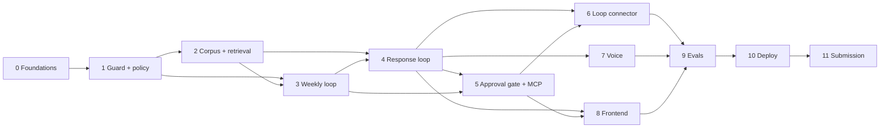

# Implementation Plan: The Support Desk

> Phase-wise build plan for the system in [architecture.md](architecture.md), meeting the requirements in [problemstatement.md](problemstatement.md).
> Stack: FastAPI, Postgres with pgvector on Neon, Groq (gpt-oss and Whisper), fastembed, React with Vite, Render and Vercel. Cost target: ₹0.

---

## How to use this plan

- **Phases are ordered by dependency.** Each phase ends with an **exit check**, a short list of things that must be true before moving on. Don't start a phase until the previous exit check passes.
- **The code-level safety pieces come first.** The ingress guard and policy engine are built and tested before any model call exists. Every later phase plugs into them, so safety is never retrofitted.
- **Every phase adds tests.** Deterministic tests run in CI from Phase 0. Tests that call Groq are marked and run on demand, so CI never burns the free quota.
- **Effort estimates** assume one person working part-time, about 3 to 4 hours a day. Total is about 6 weeks. Phases 8 and 9 can overlap with earlier phases if time is short.

### Phase overview

| Phase | Name | Main output | Estimate |
|---|---|---|---|
| 0 | Foundations | Repo, config, database, Groq adapter, CI | 2–3 days |
| 1 | Ingress guard and policy engine | PII redaction and all validators, fully tested | 3 days |
| 2 | Corpus and retrieval | 20-page corpus, hybrid retrieval, Facts Agent | 4 days |
| 3 | Weekly loop | Clustering, themes, fee detector, pulse, explainer | 4–5 days |
| 4 | Response loop | Splitter, intent, three agents, orchestrator, reviewer, refinement | 6–7 days |
| 5 | Approval gate and MCP | Pending actions, approvals, and the existing MCP server connected for Google Docs and Gmail drafts | 2–3 days |
| 6 | Loop connector | Question clusters into the pulse, canonical explainers into replies | 2–3 days |
| 7 | Voice | Groq Whisper transcription, transcript confirmation, spoken replies | 2–3 days |
| 8 | Frontend | Six views | 5–6 days |
| 9 | Evaluations | Six eval suites and a results report | 4 days |
| 10 | Deployment and hardening | Live app on free tiers, weekly cron, auth | 2–3 days |
| 11 | Submission | README, samples, eval results, demo | 2 days |

### Dependency graph

Phase 3 needs Phase 2's retriever only for the fee explainer. Clustering can start as soon as Phase 1 is done. The frontend can start after Phase 4 using the real API. Deployment can be tried early, at the end of Phase 2, to catch hosting problems sooner.

---

## Phase 0: Foundations

**Goal:** a running skeleton that every later phase builds on.

### Tasks
- [x] **Repository.** Create the layout from architecture section 18. Initialise git with a Python `.gitignore` and a Node `.gitignore`. Add `.env.example` listing every variable.
- [x] **Python project.** Use `uv` or `poetry` with Python 3.12. Core dependencies: `fastapi`, `uvicorn`, `pydantic`, `pydantic-settings`, `sqlalchemy[asyncio]`, `asyncpg`, `alembic`, `pgvector`, `openai` (for Groq's compatible API), `httpx`, `tenacity`, `structlog`, `pytest`, `pytest-asyncio`.
- [x] **Config.** One `Settings` class loaded from environment variables. It holds the Groq key, database URL, model names per task, rate limits per model, Google credentials and the cron trigger token. Model names live here, never in code.
- [x] **Database.**
  - Create a free Neon project and enable the `vector` extension.
  - Set up a local Postgres with pgvector in `docker-compose.yml` (image `pgvector/pgvector:pg16`).
  - Set up Alembic, and write the first migration with every table from architecture section 12.
  - Add a `text_redacted` naming rule: every user-text column ends in `_redacted`. Phase 1 adds a test that relies on this.
- [x] **Groq adapter skeleton** (`backend/app/llm/`).
  - `LLMClient.complete(task, messages, json_schema=None)` picks the model from config by task name.
  - Uses the `openai` client pointed at Groq's base URL.
  - **Response cache from day one**, stored in a Postgres table keyed by `sha256(model + prompt + input)`. This saves quota during all of development.
  - Token-bucket rate limiter per model, plus retry on rate-limit errors using the `retry-after` header, with at most 3 retries.
  - Records token counts for each call.
- [x] **Logging.** Set up `structlog` for JSON logs with a request id. Add a placeholder for the PII filter, which Phase 1 completes.
- [x] **FastAPI app** with a `/health` endpoint that checks the database and Groq connections.
- [x] **CI.** Add a GitHub Actions workflow running lint (`ruff`), type checks (`mypy` on core modules) and `pytest -m "not llm"`.
- [x] **Test markers.** `@pytest.mark.llm` marks tests that call Groq. CI skips them.

### Exit check
- `docker compose up` starts Postgres and the API, and `/health` returns OK.
- A test call through the adapter returns a Groq response, and a second identical call is served from the cache.
- Migrations apply cleanly to both local Postgres and Neon.
- CI passes on push.

---

## Phase 1: Ingress Guard and Policy Engine

**Goal:** the deterministic enforcement layer, complete and heavily tested before any model writes text.

### Tasks: ingress guard (`backend/app/guard/`)
- [x] **Regex detectors** for each PII type in architecture section 6.1: PAN, Aadhaar with Verhoeff checksum, Indian mobile numbers, email, account or folio numbers near keywords, and OTPs near keywords.
- [x] **Spoken-number normaliser.** Converts "nine eight seven six…" and "double five" into digits before detection. Needed for voice in Phase 7, but built here so the guard is complete.
- [x] **spaCy** `en_core_web_sm`, used directly for person names at ingress only (Presidio dropped, see [guardrails.md](guardrails.md)). Indian ID formats stay with the regex detectors.
- [x] **Redactor.** Replaces each match with a typed token such as `[PAN_REDACTED]`. Returns `(clean_text, pii_flags)`. The original value is never returned, stored or logged.
- [x] **Log filter.** Every log record passes through the detectors before it is written. Each hit increments the `pii_log_redactions` counter.

### Tasks: policy engine (`backend/app/policy/`)
- [x] One validator function per rule in architecture section 6.2. Each returns `RuleResult(rule, passed, detail)`.
  - `citation_required`: every factual sentence links to a chunk id that exists, on an allow-listed domain.
  - `advice_guard`: keyword and phrase list, written as data in a YAML file so it is easy to audit and extend.
  - `returns_guard`: percentages near return words. Must allow expense ratio and exit load percentages.
  - `pii_guard`: re-runs the ingress detectors.
  - `length_caps`: sentence counting must handle abbreviations such as "Rs.", "e.g." and "approx.", and decimals such as "1.5%".
  - `last_checked_present`, `explainer_sources`, `theme_provenance`.
- [x] `run_policy(artifact_type, artifact) -> list[RuleResult]` picks the right validators for each artefact type.
- [x] **Database write guard.** A SQLAlchemy `before_insert` and `before_update` hook runs `pii_guard` on every column ending in `_redacted`. Any hit raises an error, so unredacted text can't be stored even by mistake.

### Tests
- [x] At least 60 PII cases covering valid formats, spaced and dashed formats, lower case, spoken forms, and false-positive traps such as a 12-digit number that fails the Aadhaar checksum, or "SIP of 5000".
- [x] At least 40 advice and returns cases, including subtle phrasing ("staying invested longer may help") and allowed phrasing ("you should receive your statement by email", "exit load is 1%").
- [x] Sentence counter tests with abbreviations and decimals.
- [x] A test that tries to insert a PAN into a `_redacted` column and expects an error.

### Exit check
- All guard and policy tests pass in CI without any network access.
- The advice keyword false-positive cases are documented, with a decision for each: allow, or accept the false positive.

---

## Phase 2: Corpus and Retrieval

**Goal:** the Milestone 1 corpus rebuilt as a clean, tagged, searchable store, and a Facts Agent that answers only from it.

### Tasks: source list
- [ ] **Write `backend/corpus/sources.yaml`** with about 20 entries, following the problem statement corpus plan:
  - HDFC Mutual Fund, 12–14 entries. For each of the 5 schemes: the scheme page, KIM or SID, and the latest factsheet. Plus the TER disclosure page, the exit load or charges page, the statement and capital-gains guides, and the investor FAQ.
  - SEBI, 3–4 entries: the investor charter, the riskometer circular, the categorisation circular and the TER rules.
  - AMFI, 3–4 entries: investor education pages on SIP, ELSS, exit load, expense ratio and the riskometer.
  - Each entry holds `url, publisher, doc_type, schemes[]`.
- [ ] **Confirm the scheme names** against the current SIDs, as the problem statement asks. Update both documents if any name changed.

### Tasks: ingestion pipeline
- [ ] **Fetcher.** Uses `httpx` with a domain allow-list. It refuses any URL outside `hdfcfund.com`, `sebi.gov.in`, `amfiindia.com` and the INDMoney help domain. Raw downloads are cached locally so re-runs don't re-download.
- [ ] **Parsers.** `pdfplumber` for PDFs, keeping tables as rows. `readability-lxml` or `trafilatura` for HTML.
- [ ] **Chunker.** About 400 tokens with 50 overlap. Never splits a table row. Keeps the section heading in each chunk.
- [ ] **Metadata tagger.** Sets scheme, doc type, publisher, section and `fetched_at`. Tags INDMoney pages as `platform_process`.
- [ ] **Embedder.** fastembed with `BAAI/bge-small-en-v1.5`. Stores vectors in `corpus_chunk.embedding`.
- [ ] **CLI command** `python -m corpus.ingest` loads everything. A `--refresh` flag re-fetches and updates `fetched_at`.

### Tasks: retrieval and Facts Agent (`backend/app/agents/facts.py`)
- [ ] **Hybrid retrieval.** Postgres full-text search (BM25-like) plus pgvector cosine similarity, merged with reciprocal rank fusion. Filtered by the scheme slot when one is known. INDMoney chunks are excluded unless the intent is a platform process question.
- [ ] **Facts Agent.**
  - Takes the top 3–4 chunks and calls the large Groq model with a strict "answer only from these passages" prompt. Uses JSON mode to return `{answer, chunk_id}` or `{not_covered: true}`.
  - **Number check:** every number in the answer must appear in the cited chunk's text. Otherwise the result becomes `not_covered`.
  - Low retrieval scores give `not_covered` without a model call.
  - Fills `searched` with the queries, filters and top chunk ids for every result.
- [ ] **Retrieval test set** of 25 questions with the expected chunk or source, covering all 5 schemes and the common facts: expense ratio, exit load, minimum SIP, lock-in, riskometer, benchmark and statements.

### Exit check
- The corpus loads with 15–25 sources, and every chunk has a scheme tag (or "general") and a `fetched_at` date.
- On the retrieval test set, the correct source is in the top 4 for at least 90% of questions.
- The Facts Agent answers the test set with correct citations, and returns `not_covered` with search details for 5 out-of-scope questions.
- **Optional early deploy:** push the API to Render with Neon, and confirm fastembed fits in the 512 MB memory limit.

---

## Phase 3: Weekly Loop

**Goal:** the Milestone 2 pipeline running end to end with no manual steps, up to "awaiting approval".

### Tasks: reviews data
- [ ] **Collect INDMoney reviews** from the last 8–12 weeks of Play Store and App Store reviews, for example with the `google-play-scraper` package and the App Store RSS feed. Save as CSV with `review_id, source, date, rating, text`.
- [ ] **Clean the sample.** Run the ingress guard over it and commit only the redacted version as `data/reviews_sample.csv`.

### Tasks: pipeline (`backend/app/weekly/`)
- [ ] **Run record.** `weekly_run` with the window and a `stage_log`. Each stage saves its status, so an interrupted run resumes from the last finished stage.
- [ ] **Ingest.** Guard, window filter, near-duplicate removal and insert.
- [ ] **Cluster.**
  - Embed reviews, plus any queue questions in the window once Phase 4 exists.
  - Reduce dimensions with PCA, then run KMeans for k = 2 to 5 with a fixed seed. Pick k by silhouette score.
  - Store `review_ids` and `count` per theme.
- [ ] **Label themes** with the small model, using the 8 reviews closest to each cluster centre. The output is a short label plus a one-line description.
- [ ] **Rank** themes by count and mark the top 3.
- [ ] **Quotes.** The model picks 3 review ids from the top themes. Code copies the text and checks it is a substring of the stored review. The model never writes quote text.
- [ ] **Fee confusion detector.** Fee lexicon scoring as in architecture section 8.2, with a minimum-count threshold. If none qualifies, the run records "no fee confusion this week".
- [ ] **Fee explainer.** Retrieves through the Phase 2 retriever, filtered to fee documents. The large model writes at most 6 bullets. Code attaches 2 source links and the `Last checked` date from `fetched_at`.
- [ ] **Weekly pulse.** The large model writes it from the top themes, quotes, counts and windows, with at most 250 words and 3 action ideas.
- [ ] **Validation.** Run the policy engine on both. On failure, regenerate once with the named failure. On a second failure, mark the run failed and show why.
- [ ] **Trigger endpoint.** `POST /weekly/run` runs the loop as a FastAPI background task and returns the run id immediately. It is protected by the trigger token. `GET /weekly/{run_id}` returns the run status for polling.
- [ ] **Resume on startup.** A startup hook finds runs left `in_progress` and resumes each from its last finished stage.
- [ ] **Pending actions for the run.** A validated run creates a doc append and an email draft action, plus a `promote_canonical` action when it has a fee explainer. The gate that executes them comes in Phase 5.

### Tests
- [ ] A fixed fixture CSV gives a reproducible set of clusters, using the fixed seed.
- [ ] Every theme has review ids and a window. Every quote is a verbatim substring.
- [ ] Pulse and explainer stay within their caps on 3 runs.
- [ ] A fixture with no fee mentions produces "no fee confusion" and no explainer.

### Exit check
- One trigger runs the full loop on the real CSV to "awaiting approval" with no manual step.
- The detected fee issue is recorded. Check whether it confirms the exit load hypothesis, and note the result for the README.

---

## Phase 4: Response Loop

**Goal:** the Milestone 3 desk rebuilt on the shared guard, policy engine and retriever, with question splitting and intent handling.

Build it in this order. Each step is testable on its own.

### 4.1 Message intake and splitter (`backend/app/intent/splitter.py`)
- [ ] `POST /chat/message` runs the guard, then the splitter, then creates one `message` row and one `queue_item` per part.
- [ ] **Code rules** split on question marks, lists, line breaks, and joining words when both sides contain a question word or verb.
- [ ] **Model fallback** uses the small model only when the rules are unsure, returning JSON parts.
- [ ] **Coverage check.** Parts must be built from the original words. If not, fall back to a single part.
- [ ] **Shared slots** carry scheme and fee type to parts that lack them, and resolve pronouns to the nearest named scheme.
- [ ] **Cap and deduplicate.** Keep at most 5 parts, store the dropped ones in `parts_dropped`, and merge duplicates.
- [ ] **Tests:** 25 split cases, including single questions, lists, shared schemes, pronouns, more than 5 parts, and tightly linked questions.

### 4.2 Intent classifier (`backend/app/intent/classifier.py`)
- [ ] **Keyword pre-rules** for advice and returns that the model can't override.
- [ ] **Small model** with the 7 labels, a confidence score and slots, using JSON mode.
- [ ] **Low confidence** becomes `unclear`, which produces one clarifying question.
- [ ] **Session memory** stores the last scheme and the sticky `advice_refused` flag in the `chat_session` table, keyed by session id and linked to the logged-in user. It holds only redacted text and expires after a set time.
- [ ] **Unclear questions** get a clarifying question stored as a draft with `source_type = clarification`, so every queue item still ends with a draft.
- [ ] **Start the labelled intent set** in `evals/datasets/intents_labelled.jsonl` now, with at least 30 questions. Use it to tune the pre-rules.

### 4.3 Three agents (`backend/app/agents/`)
- [ ] **Facts Agent** from Phase 2.
- [ ] **Rolling question clusters.** Each new queue item joins the nearest `question_cluster` above a similarity threshold, or starts a new one. Built here because the Pattern Agent needs it. Phase 6 adds surfacing on top.
- [ ] **Pattern Agent.** Embed the question, match it against the latest theme centroids and the rolling question clusters, and compute counts in SQL. Apply the recurring and rising rules from architecture section 7.4. No model call.
- [ ] **Compliance Agent.** Uses the guard's `pii_flags` plus the advice and returns detectors on the incoming text. Calls the small model only when the code checks are inconclusive.
- [ ] **Parallel run.** `asyncio.gather` over the three agents, with an `agent_run` row for each that stores its start time, end time and output. The overlapping times are the proof that they run in parallel.

### 4.4 Orchestrator (`backend/app/orchestrator/`)
- [ ] **Route by intent.** Refusal templates for advice and returns, with AMFI, SEBI or factsheet links. The canonical explainer path stays a stub until Phase 6. The full draft path covers the rest.
- [ ] **Drafting.** The large model writes a reply of at most 3 sentences from the Facts result only. Code attaches the citation and `Last checked` date. The model never writes URLs.
- [ ] **Routing note.** The deterministic rules table from architecture section 7.5, plus the disagreement rule.
- [ ] **Draft versioning.** Every draft is a new `draft_version` row.

### 4.5 Reviewer (`backend/app/reviewer/`)
- [ ] Run the policy engine, plus the large-model advice judge, which can only add failures.
- [ ] On a fail, send the named failure back to the orchestrator once. On a second fail, mark the draft `blocked`.
- [ ] **The API refuses to approve a blocked draft.** Enforce this in the service layer, not only in the UI.

### 4.6 Refinement and human decisions
- [ ] **All human text goes through the ingress guard** before storage or any model call. That covers refinement feedback, draft edits and corrected transcripts.
- [ ] `POST /queue/{id}/refine` classifies the feedback, re-runs only the affected agents (architecture section 7.7), reuses cached outputs and logs `agents_fired`. Refuse a sixth round.
- [ ] `PUT /queue/{id}/draft` stores the human edit as a new version and re-runs the policy engine. Edits are allowed on blocked drafts, and a corrected version that passes can be approved.
- [ ] `POST /queue/{id}/approve` accepts the draft and creates its two pending actions. It writes nothing to Google.
- [ ] `POST /queue/{id}/reject` changes only that item's status.
- [ ] `POST /queue/import-csv` turns selected review rows into queue items.

### Tests
- [ ] **Branch tests:** a clean answer, a not-covered question, a recurring theme, a PII message, an advice request and a returns request. Check the agents fired, the routing and the reviewer result for each.
- [ ] **Mixed multi-question message:** factual parts are answered and the advice part is refused, each with its own citation or refusal link.
- [ ] **Session refusal holds** when the advice question is rephrased later in the session.
- [ ] **PII in human text:** an edit and a refinement note containing a PAN are both redacted before storage.
- [ ] **Reviewer rework:** a fake orchestrator produces an uncited draft. Check it is sent back once, then blocked.
- [ ] **Refinement:** each feedback type fires only its agents, and the sixth round is refused.

### Exit check
- 20 real complaints from the CSV all produce structured output from all three agents, plus a draft or "not covered".
- Agent run timings show the three agents overlapping.
- No blocked draft can be approved through the API.

---

## Phase 5: Approval Gate and MCP

**Goal:** a gate that a compliance team would trust. Nothing is written without one human approval per action.

### Tasks: connect the existing MCP server

The Google Docs and Gmail MCP server built earlier is reused as-is. No new MCP server is written. The server stays a plain executor: all approval logic lives in this project's gate, before any tool is called.

- [ ] **Bring it into the project.** Add the server as a `mcp_server/` folder or a git submodule, so it is versioned with the backend and deploys with it. Record its source and version in the README.
- [ ] **List its tools.** Connect with the `mcp` Python SDK client, call `list_tools`, and record each tool's name and input schema. Identify the tool that appends to a doc and the tool that creates a Gmail draft.
- [ ] **Block sending.** If the server has a send-email tool, or any tool other than the two needed:
  - Preferred: disable or remove it in the server's configuration, so it is never loaded.
  - Required either way: the backend's tool allow-list (`backend/app/mcp/allowlist.py`) names only the doc-append and create-draft tools. The client refuses every other tool name before it reaches the server.
- [ ] **Check the transport.**
  - **stdio server:** the backend starts it as a subprocess. Its runtime and dependencies go into the backend's Docker image, so it runs in the same Render container.
  - **HTTP server:** it needs its own free hosting, plus a shared secret between the backend and the server. Prefer stdio, because a second free service adds another thing that can sleep or fail.
- [ ] **Move its Google credentials to environment variables.** A sign-in token saved on a laptop won't exist on Render. Pass the client id, client secret and refresh token as environment variables.
- [ ] **Narrow the Google permissions.** If the existing token has broad Gmail access, create a new one with only the Docs scope and `gmail.compose`. With compose only, Google itself would reject a send even if the allow-list failed.
- [ ] **Check what the tools return.** The gate stores a result id for each executed action, such as the doc id and revision or the Gmail draft id. If a tool returns only a success message, add a small adapter in `backend/app/mcp/` that records what is available, or extend the server to return the id.
- [ ] **Map payloads to tool inputs.** Write one mapping function per action kind that turns a pending action's payload (architecture section 10.3) into the tool's input schema. Hash the payload, not the mapped input, so the approval matches what the approval screen showed.
- [ ] **MCP client** (`backend/app/mcp/`). `execute(action_id, approval_id)` is the only function that calls a tool. It re-checks the approval in the database, applies the allow-list, calls the tool with a timeout, and returns the result or a clear error.

### Tasks: gate (`backend/app/gate/`)
- [ ] **Creating pending actions.**
  - A weekly run that passes validation creates two pending actions: a doc append and an email draft.
  - Approving a queue draft creates its doc append and reply email draft.
  - Each action stores its full payload and a `payload_hash`, computed from canonical JSON with sorted keys.
- [ ] **Approval endpoint.** `POST /actions/{id}/approve` with the `payload_hash`, inside one database transaction:
  1. Lock the action row.
  2. Check the status is `pending` and the hash matches.
  3. Insert the approval row. Its `action_id` is unique.
  4. Call `execute`.
  5. Store the result id, or mark the action `failed` with the error.
- [ ] **Reject endpoint.** Marks only that action.
- [ ] **Internal action.** `promote_canonical` uses the same approve endpoint, hash check and approval row, but writes to the database instead of calling a tool.
- [ ] **Reply drafts have no recipient.** Customer emails are never stored, so the support agent adds the recipient in Gmail.
- [ ] **Combined reply.** `POST /messages/{id}/combined-reply` is available only when every part is approved or rejected. It creates one new pending email-draft action, which needs its own approval.
- [ ] **Payload formats** from architecture section 10.3, including the weekly email subject `Weekly Product Pulse + Customer Clarification — <date>`.

### Tests
- [ ] `execute` without a valid approval raises an error.
- [ ] Approving with a stale hash is rejected.
- [ ] Approving the doc append leaves the email draft pending.
- [ ] A double click executes once.
- [ ] Approving the weekly doc append does not create a canonical explainer. Only approving `promote_canonical` does.
- [ ] The MCP client refuses any tool name outside the allow-list, including the server's send tool if it has one.
- [ ] **Contract test** against the real server: call `list_tools` and check the two allowed tools still exist with the expected input schemas. This catches changes to the server early.
- [ ] A tool timeout or server error marks the action `failed` and leaves it retryable, with nothing written twice.

### Exit check
- One real weekly run is approved, which appends a real entry to the Google Doc and creates a real Gmail draft. Save both for the submission.
- One real queue draft is approved, with the same results.

---

## Phase 6: Loop Connector

**Goal:** the link between the two loops. This is the core new work, so it must be demonstrable.

### Tasks (`backend/app/connector/`)
- [ ] **Surfacing.** Builds on the rolling question clusters from Phase 4. Mark a cluster `surfaced` when it has 5 or more items within 7 days.
- [ ] **Into the weekly loop.** The weekly pipeline loads surfaced clusters and must include each one as a theme or as the key observation, with count, window and queue item ids. Add a validator check that no surfaced cluster is missing from the pulse.
- [ ] **Canonical explainers.** Executing an approved `promote_canonical` action writes a `canonical_explainer` row. A newer one for the same fee type deactivates the old one.
- [ ] **Into the response loop.** Complete the orchestrator's canonical path from Phase 4. On a `fee_canonical` intent, or when a question is close to a canonical explainer's embedding, build the reply from 1–3 of its bullets. Keep its citation and set `source_type = canonical_explainer`.
- [ ] **Reuse counter** on each canonical explainer, for the frontend view.

### Tests
- [ ] Seed 5 similar questions within 7 days, run the weekly loop, and check the cluster appears in the pulse with its count and window.
- [ ] Approve the `promote_canonical` action, ask a related question, and check the reply uses the explainer.
- [ ] Approve a newer explainer and check the old one is no longer used.

### Exit check
- Both directions work end to end on real data, and the steps are written down as a demo script for Phase 11.

---

## Phase 7: Voice

**Goal:** spoken questions follow the same safe path as typed ones.

### Tasks (`backend/app/voice/`)
- [ ] **`POST /chat/voice`** accepts an audio blob of at most 30 seconds. It reads into memory, never to disk. Request-body logging is turned off for this route.
- [ ] **Transcription.** Send the audio to Groq Whisper (`whisper-large-v3-turbo`), passing the 5 scheme names and fee terms in the `prompt` parameter. Drop the buffer immediately afterwards.
- [ ] **Guard first.** Normalise spoken numbers, then redact, then return the clean transcript for confirmation. The unredacted transcript is never stored or returned.
- [ ] **Fuzzy scheme matching** fixes near-misses, such as "big cap" to "mid cap", using `rapidfuzz` against the 5 scheme names. Suggestions are shown to the user, never applied silently.
- [ ] **Confirmed transcript** goes to `/chat/message` with `channel=voice`, so it uses the same splitter and pipeline.
- [ ] **Record test audio.** Save 10 clips for the parity eval and 3 clips containing a spoken PAN, account number and phone number.
- [ ] **Look up Groq's data retention policy** for audio, and record it for the README's known limits.

### Exit check
- The 10 test clips transcribe accurately, or are fixable at the confirmation step.
- The spoken PII clips come back redacted, and a log and database search finds nothing.

---

## Phase 8: Frontend

**Goal:** the six views the problem statement requires, on top of the real API.

### Tasks (`frontend/`)
- [ ] **Setup:** Vite, React, TypeScript, Tailwind CSS, React Router, and TanStack Query for API calls. A typed API client generated from FastAPI's OpenAPI schema, for example with `openapi-typescript`.
- [ ] **Layout:** a side navigation and a disclaimer banner on every page reading "Facts-only. No investment advice."
- [ ] **Chat view.**
  - Welcome line and 3 example questions.
  - Text input and a microphone button using `MediaRecorder` with a 30-second cap.
  - Transcript confirmation box with scheme-name suggestions.
  - One answer block per question, each with its own citation chip, last-checked date and status: answered, refused, not covered or blocked.
  - A play button that reads replies with `speechSynthesis`, each answer prefixed with its question.
- [ ] **Queue view.**
  - A table grouped by parent message, with channel, intent, status, pattern badge, flags and routing.
  - A detail drawer with draft versions, outputs from all three agents, a timing bar showing the parallel run, reviewer results and the refinement log.
  - Approve, edit, reject and refine controls. Approve is disabled for blocked drafts, matching the server rule.
- [ ] **Weekly pulse view.** A run list with a trigger button. Theme cards show counts and windows, and clicking a count lists its review ids. Shows quotes, the pulse text, the fee explainer, and "from support queue" tags.
- [ ] **Sources panel.** Each source with its publisher, last-checked date, and the drafts that cite it.
- [ ] **Approval screen.** One card per pending action with the kind, target and full payload preview. One approve and one reject button per card. The approve request sends the `payload_hash` shown on the card.
- [ ] **Canonical explainers view.** Active explainers with bullets, sources, approval date and reuse count. Pending `promote_canonical` actions show here with a link to the approval screen.
- [ ] **Login** in front of every view, including chat, as described in Phase 10. The chat is an agent-assist console, not a customer-facing page.

### Exit check
- Every flow in the demo script can be done in the browser without the API docs.
- Layouts work at laptop width. Phone width is nice to have.

---

## Phase 9: Evaluations

**Goal:** the problem statement's evaluations, run over the assembled system, with results committed.

### Tasks (`evals/`)
- [ ] **Datasets:**
  - `intents_labelled.jsonl`: at least 30 questions across the 7 intents. Started in Phase 4.
  - `adversarial.jsonl`: advice, returns and PII messages, each rephrased 2–3 ways, with repeats in the same session.
  - `not_covered.jsonl`: at least 8 questions outside the corpus.
  - `complaints_20.jsonl`: 20 real complaints from the CSV.
  - `multi_question.jsonl`: at least 15 multi-part messages with their expected parts and intents.
  - `voice/`: clips from Phase 7.
- [ ] **Test harness.** Runs against a fresh test database through the HTTP API. Uses the Groq cache, so re-runs are cheap. A `--fresh` flag clears the cache for a real run.
- [ ] **Suites** from architecture section 15:
  - `test_feasibility.py`: every queue item has a draft or "not covered". Theme provenance and windows. Pulse and explainer caps. The weekly run completes unattended.
  - `test_edit_correctness.py`: a `snapshot()` helper dumps every table to sorted JSON. For each edit, approve and reject, take a snapshot before and after, diff them, and assert only the expected rows changed.
  - `test_grounding_compliance.py`: sample 15 claims across both loops and resolve each to a chunk or review id. Run the not-covered and adversarial sets in both loops, typed and spoken. Then search the logs and every `_redacted` column with the PII detectors and expect zero hits.
  - `test_voice_intent.py`: intent accuracy with a confusion table, voice versus typed parity, and spoken PII.
  - `test_multi_question.py`: parts, intents, shared slots, the cap, and per-part rejection.
  - `test_loop_connection.py`: both directions.
- [ ] **Report.** `run_all.py` writes `evals/results/<date>.md` and `.json` with pass and fail counts, failing cases, intent accuracy, the not-covered rate, reviewer fail rates by rule, and the number of Groq calls used.
- [ ] **Iterate.** Fix the top failures, such as keyword false positives, splitter mistakes or prompt issues. Re-run, and keep both reports. The before-and-after comparison is evidence for the "iteration depth" part of the rubric.

### Groq quota tip
A full fresh run is roughly 80–100 questions at about 4 calls each. Spread the first fresh run across two days if the daily limit is hit. After that, cached re-runs cost almost nothing.

### Exit check
- All suites run with one command, and a results report is committed.
- Grounding and compliance has zero PII hits and zero unrefused advice or returns cases. Any other failures are listed as known limits with a reason.

---

## Phase 10: Deployment and Hardening

**Goal:** a stable hosted app on free tiers.

### Tasks
- [ ] **Backend on Render free.** Use a Dockerfile with a slim Python image and download the spaCy small model at build time. If the existing MCP server is a stdio server, copy it into the same image with its runtime and dependencies. If it is written in Node, add Node to the image. Set the environment variables. The start command runs `alembic upgrade head`, then `uvicorn`.
- [ ] **Database on Neon.** Run migrations, then the corpus ingest, then the reviews load.
- [ ] **Frontend on Vercel.** Set the API base URL as an environment variable. Configure CORS on the backend for the Vercel domain only.
- [ ] **Weekly cron.** `.github/workflows/weekly.yml` calls `POST /weekly/run` with the trigger token every Monday at 03:30 UTC, which is 09:00 IST. Include a warm-up call to `/health` with retries first, because the service may be asleep. After triggering, **poll the run status every minute until it finishes**. This keeps Render from sleeping mid-run, and fails the GitHub job if the run fails.
- [ ] **Auth.** Simple username and password login for every view, including chat, storing hashed passwords and using a signed session cookie. The approver's username is recorded on every approval.
- [ ] **Memory check.** Watch Render's memory graph during a weekly run and a queue burst, and confirm it stays under 512 MB.
- [ ] **Failure behaviour.** Simulate Groq errors and check that items show "temporarily unavailable" and nothing is sent unchecked. Exhaust a model's quota and check that the fallback model tag appears.
- [ ] **Security pass.** No secrets in the repo, the trigger token is required, the CORS allow-list is set, and the audio route has no body logging. The MCP server's Google credentials come only from environment variables, and no token files are committed from the earlier project.
- [ ] **MCP check on the hosted app.** Approve one action on Render and confirm the doc entry and Gmail draft appear. This confirms the server starts in the container and the credentials work there.

### Exit check
- The hosted app runs the full demo script.
- A scheduled cron run completes without manual help, and its pending actions appear on the approval screen.

---

## Phase 11: Submission

**Goal:** everything the problem statement's deliverables section asks for.

### Tasks
- [ ] **README.md** covering:
  - The architecture overview and diagram, linking to `docs/architecture.md`
  - Setup for local and hosted environments
  - The source list, generated from `sources.yaml`
  - Where the approval gate sits
  - How the two loops connect
  - The fee issue found in the reviews, with its evidence counts
  - How to run the evals
  - Known limits, including Groq audio handling and free-tier limits
- [ ] **Artefacts:**
  - `data/reviews_sample.csv`, redacted
  - `samples/` holding 5 sample questions with their drafts, including one multi-part message and one refusal, the appended doc entry, and the email draft as text and a screenshot
  - `evals/results/`, holding the before and after reports
- [ ] **Prototype link** to the hosted app, with a demo login for the graders.
- [ ] **Demo video under 3 minutes**, as a fallback. Script:
  1. Trigger the weekly loop, show the themes with review ids, and approve the doc append and email draft.
  2. Ask one typed question and show the three agents in parallel and the cited reply.
  3. Ask one spoken multi-part question with an advice part, and show the refusal next to the answers.
  4. Show one reviewer rejection with its named failure.
  5. Show the canonical explainer being reused.
  6. Run one eval suite.
- [ ] **Final check against the problem statement's rules.** Go through all 11 rules and point to the code or test that enforces each.

### Exit check
- A fresh clone, following only the README, can run locally and run the evals.

---

## Requirement Traceability

Every requirement maps to the phase that builds it and the eval that proves it.

| Requirement (problem statement) | Built in | Proved by |
|---|---|---|
| Every factual claim has one source link | 2, 4 | Grounding and compliance |
| Public sources only | 2 (fetcher allow-list) | Grounding and compliance |
| "Not covered" names what was searched | 2 | Grounding and compliance |
| Themes trace to review ids, counts state a window | 3 | Feasibility |
| No PII anywhere | 1, 7 | Grounding and compliance, voice and intent |
| One human approval per action | 5, 6 (canonical promotion as its own action) | Edit correctness |
| Nothing reaches a customer without approval | 8, 10 (login on every view, chat is internal) | Edit correctness, manual check |
| Length caps | 1, 3, 4 | Feasibility |
| No returns or performance claims | 1, 4 | Grounding and compliance |
| Three agents run in parallel | 4 | Agent timing in the queue drawer |
| Reviewer rework at most 1, refinement at most 5 | 4 | Phase 4 tests |
| Weekly loop runs unattended | 3, 10 | Feasibility |
| Loops connected in both directions | 6 | Loop connection |
| Voice and intent handling | 4, 7, 8 | Voice and intent, multi-question |
| Scope enforced in code | 1 | Phase 1 tests |
| Deployed app | 10 | Hosted link |

---

## Risks and Mitigations

| Risk | Impact | Mitigation |
|---|---|---|
| Groq daily limits hit during development or evals (1,000 requests per day per model on this key) | Work stalls for the day | Cache from Phase 0. Use the small model wherever possible. Spread fresh eval runs across days. |
| A Groq model is retired | Calls fail | Model names live in config. This already happened once: the Llama models were retired before Phase 0 and replaced with gpt-oss through config only. Check the Groq console at the start of each phase. |
| HDFC pages change URL or are blocked | Corpus ingest fails | Cache raw downloads. Keep a local copy of each PDF for re-ingest. |
| Too few fee-related reviews | No fee issue detected | Widen the window to 12 weeks. If still too few, report "no fee confusion detected" honestly, and use the strongest charge-related theme as a documented fallback. |
| Render free memory exceeded | Service crashes | Check memory at the end of Phase 2. Fall back to Koyeb or Hugging Face Spaces, which offer more free memory. |
| Existing MCP server doesn't run on Render | Approved actions fail in production | Test it inside the Docker image locally in Phase 5. If the runtime doesn't fit, run it as a small HTTP service on another free host, protected by a shared secret. |
| Existing MCP server can send email | Risk of an automatic send | Allow-list in the client, the send tool disabled in the server, and a Gmail token limited to compose. Three independent layers. |
| Google refresh token expires | MCP actions fail | Tokens for apps in Google's testing mode expire after about 7 days. Refresh the token before the demo and grading, or publish the OAuth app as internal or in production. |
| Keyword guards too strict | Good replies blocked | Track false positives in the evals. Tune the YAML lists. Document what remains. |
| Time overrun | Missing deliverables | If short on time, cut in this order: phone layout, Presidio name detection, the combined multi-question reply, the fallback model. Never cut the guard, the gate, the loop connector or the evals. |
